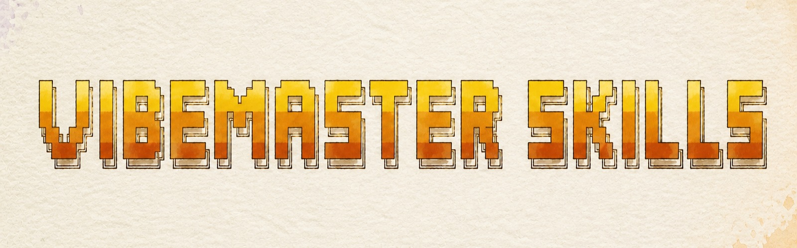
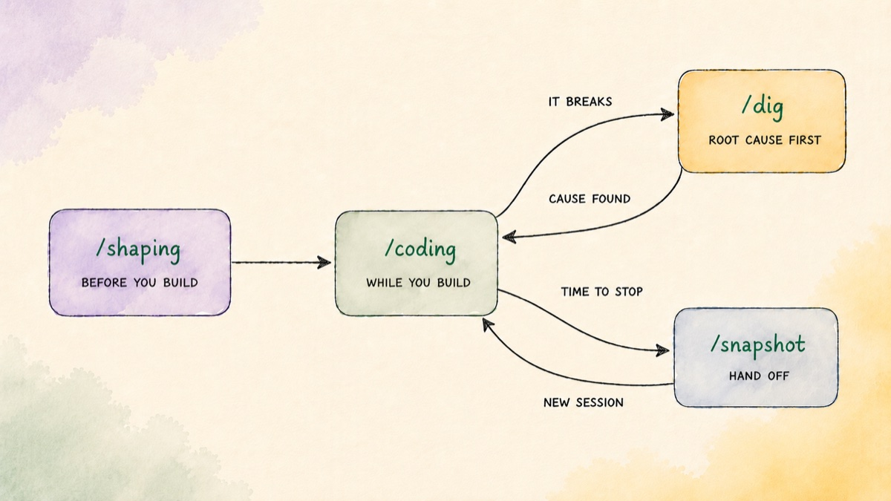

<div align="center">
  
  <h1>VIBEMASTER</h1>
  <p><b>The stronger, lightweight Superpowers alternative: four skills, one closed loop.</b></p>
  <p>
    <a href="https://github.com/liustack/vibemaster/actions/workflows/ci.yml"></a>
    <a href="https://skills.sh/liustack/vibemaster"></a>
    <a href="LICENSE"></a>
  </p>
  <p><a href="./README.zh-CN.md">中文</a></p>
</div>

> **liustack is now vibemaster.** New name, same four skills. The install commands below already use the new `liustack/vibemaster` path.

Each skill does exactly one job: sort the idea out before you start, code to best practice while you build, dig for the root cause when things break, and snapshot when you hand off.

<p align="center">
  
</p>

## Skills

| Skill | When | What you get |
| :-- | :-- | :-- |
| [`shaping`](skills/shaping/SKILL.md) | Before you start | Turns a fuzzy idea into one of three things: a decision you can back up with reasons, a short list of options that are genuinely different from each other, or a reviewable `spec.md` / `design.md`. |
| [`coding`](skills/coding/SKILL.md) | While coding | Coding best practice, not the newest but the proven: red-green TDD, refactoring in the same pass, and an adversarial review before you call it done. |
| [`dig`](skills/dig/SKILL.md) | When there's a bug | Finds the real root cause anywhere in the stack: reproduce the bug, test hypotheses you could actually be wrong about, change one thing at a time so you know what really fixed it, and no patch goes in until the cause fully explains the symptom. Delivers an `issue.md`. |
| [`snapshot`](skills/snapshot/SKILL.md) | When handing off | A handoff document a fresh session resumes from, trusting its decisions and re-checking its facts. |

Slash commands are optional. Every skill also fires on its own trigger phrases (需求澄清, brainstorm, why does this keep failing, wrap up this session), so the discipline shows up without being summoned.

⭐ **If it works for you, [star the repo](https://github.com/liustack/vibemaster).** Stars are how the next developer finds it, and what keeps us building.

## Install

Just tell your Claude Code or Codex:

```bash
Install this for me: npx -y skills add liustack/vibemaster -g
```

Or paste this into your terminal:

```bash
npx -y skills add liustack/vibemaster -g
```

Or install it as a Claude Code plugin:

```bash
# Claude Code plugin marketplace
claude plugin marketplace add liustack/vibemaster
claude plugin install vibemaster@vibemaster        # everything
claude plugin install shaping@vibemaster       # or just one

# Codex / other agents: skills live in ~/.agents/skills
git clone https://github.com/liustack/vibemaster
ln -s "$(pwd)/vibemaster/skills/"* ~/.agents/skills/
```

> Pick either the full `vibemaster` plugin or single-skill mini plugins, not both: they ship skills with the same names.

| Where | How to invoke |
|---|---|
| Claude Code | type `/<skill>` (e.g. `/dig`), or just talk: descriptions auto-trigger |
| Codex | press `$` to open skill search and pick one (`/skills` is just the management panel) |
| Other Agent Skills tools | auto-triggered by each skill's description |

## Workflows

- **Ship a feature**: `/shaping` → approve the spec → `/coding` → merge
- **Fix a stubborn bug**: `/dig` reproduces it, digs to the root cause, and carries the fix through with a regression test
- **A build-or-not call**: `/shaping`, across as many rounds as the call needs
- **Stopping with work left**: `/snapshot` → open a fresh session → pick up where you left off

## Why vibemaster

Unlike other workflow suites, vibemaster's method is more than a checklist of habits: it is calibrated against design research and the philosophy of science, and the theory doubles as the method's regression suite, no change to the skills may contradict it. A requirement is not compressed one-way from vague to concrete. It folds and unfolds across levels, opening the space and closing it again, until it converges on a definite answer. That process has a name, [problem-solution co-evolution](https://doi.org/10.1016/S0142-694X%2801%2900009-6) (Dorst and Cross): trying solutions rewrites what you understand the problem to be, the new understanding narrows where solutions can live, and step by step an indeterminate situation takes shape ([Dewey's inquiry](https://plato.stanford.edu/entries/dewey/)).

So the four skills share one set of moves. A vague request is a space of possibilities, and every round of work does one thing: shrink it. Divergence is not a goal, it is the local move for when convergence loses its grounds: **open** genuinely different territories when every option is a rewording, **close** the moment grounds suffice, **recut** when evidence overturns the frame. One test, from [Popper](https://en.wikipedia.org/wiki/Falsifiability): output that rules nothing out is not progress. dig runs the same ruler through [Peirce's triad](https://plato.stanford.edu/entries/abduction/): abduction proposes the hypotheses, deduction derives their consequences, induction lets reality answer.

**Lighter than Superpowers.** Superpowers puts a fixed pipeline in front of development work: brainstorm, plan, then execute, whether the task needs all of it or not. vibemaster keeps four skills, one for each stage of building something, and none of them run out of habit: branching into real options, tough questioning, and review only kick in when skipping them would actually hurt, never as mandatory stops.

**And lighter is measurable.** Token cost of what actually gets loaded, with Superpowers fetched live and both sides estimated the same way. Reproduce it with `python3 tests/measure_context_savings.py`:

| What you pay | Superpowers | vibemaster |
|---|---|---|
| Every session, always | ~1,250 (14 descriptions, plus a dispatcher skill a hook re-injects after every /compact) | ~680 (4 descriptions, no hook) |
| Shipping one feature | ~12,000 (its 8-skill chain) | ~4,100 (shaping + coding) |
| Digging one bug | ~4,600 (systematic-debugging chains TDD for the fix) | ~2,600 (dig closes the loop itself) |

**And stronger where it counts.** Fewer skills, each doing more. coding holds every line to today's best practice (whether code runs and whether it's written the way people write it today are different claims, and it checks both), running TDD, refactoring, and a break-it review together in one loop, not as separate steps. And first principles and inversion do real work inside shaping and dig: they generate the hypotheses and failure criteria, instead of decorating a checklist you glance at and move past.

**grill-me only works if you remember to run it.** grill-me is a skill that stress-tests your requirements with hard questions, and you have to invoke it by hand. vibemaster's shaping fires on its own trigger phrases, asks the same kind of pointed questions built on first-principles thinking and inversion (working backward from failure), and writes every confirmed decision into the spec file the moment you make it. The questioning is automatic, and the file it produces is the deliverable.

## Uninstall

```bash
npx skills remove shaping coding dig snapshot -g
# or: claude plugin uninstall vibemaster@vibemaster
```

## License

MIT. Questions and problems are welcome as issues, and forking it into a workflow of your own is encouraged.

If you need the business-side stack (founder self-audit, niche discovery, marketing diagnosis), my open-source [opcstack](https://github.com/liustack/opcstack) has you covered.
