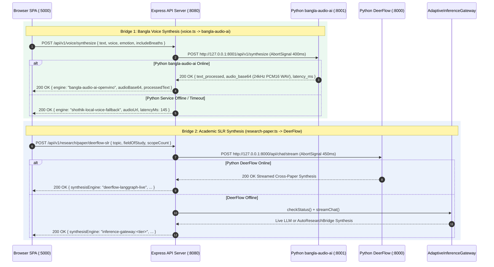
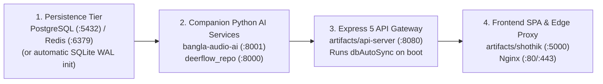

# Deliverable 2: Architecture & Data-Flow Audit (`ARCHITECTURE_AUDIT.md`)

> **Generated**: 2026-10-28 (Exhaustive Phase 3 & Phase 8 Deliverable 2 Edition)
> **Scope**: Primary Monorepo ([`C:/Users/USER/hermes/shothik-web-mirror-v2`](file:///C:/Users/USER/hermes/shothik-web-mirror-v2)) & Companion Voice AI Service ([`c:/Users/USER/hermes/bangla-audio-ai`](file:///c:/Users/USER/hermes/bangla-audio-ai))
> **Methodology**: Reconstructed directly from source code, runtime routing tables, middleware chains, database bootstrap scripts, and live multi-service integration tests.
> **Epistemic Status Markers**: Every component, data path, and service boundary is explicitly labeled as **Confirmed**, **Inferred**, or **Requiring Verification**.

---

## 1. System Architecture & Data-Flow Diagrams

### 1.1 Macro System Topology (`Confirmed` vs. `Requiring Verification`)

```mermaid
flowchart TD
    subgraph ClientTier["1. Browser Client Tier (Port 5000)"]
        SPA["React 19 + Vite 7 SPA (artifacts/shothik)"]
        NextShims["Next.js Compatibility Shims (src/lib/stubs/next-*)"]
        ViteDev["Vite Dev Middleware (localDevApiPlugin)"]
        ProdHTTP["Zero-Dep Prod Server (artifacts/shothik/server/index.mjs)"]
    end

    subgraph EdgeTier["2. Edge & Reverse Proxy Tier"]
        Nginx["Nginx Reverse Proxy (nginx.conf :80/:443)"]
        UnivGW["Local Node Gateways (universal-gateway.js / local-proxy.js)"]
        CFWorker["Cloudflare Worker (worker.ts - Static KV Assets Only)"]
        VercelEdge["Vercel Edge Rewrite (vercel.json -> api.shothikgpt.com)"]
    end

    subgraph APITier["3. Express 5 API Gateway (artifacts/api-server - Port 8080)"]
        AppEntry["Express App & Middleware (src/index.ts + src/app.ts)"]
        ShutdownSup["GracefulShutdownSupervisor (graceful-shutdown.ts)"]
        AuthMod["Auth & Token Engine (src/routes/auth.ts)"]
        LeashMod["Capability Leash & Protected Actions (capability-leash.ts / protected-actions.ts)"]
        NLPMod["Writing & Extended NLP Suite (writing-tools.ts / ai-tools-extended.ts)"]
        InfGW["6-Tier AdaptiveInferenceGateway (inference-gateway.ts)"]
        RAGEng["Hybrid Vector RAG Engine (rag-engine.ts)"]
        VoiceMod["Voice & Banglish Router (src/routes/voice.ts)"]
        ResearchMod["Academic & SLR Router (src/routes/research-paper.ts)"]
        WorkersMod["Async Queues, Sagas & Actors (jobs.ts / nightshift.ts / saga.ts / actor-supervisor.ts)"]
        SandboxMod["IsolatedCodeSandbox (src/lib/code-sandbox.ts)"]
        SkillRun["SkillRunner CLI Bridge (src/lib/skills/skillRunner.ts)"]
        DomainMod["90+ Bangladesh Commerce, Tax & Logistics Routers"]
        ProxyCatchAll["Last-Resort Catch-All Proxy (src/routes/proxy.ts)"]
    end

    subgraph StorageTier["4. Multi-Tier Persistence Layer (lib/db & Local State)"]
        PG[("PostgreSQL Primary (pg.Pool + Drizzle ORM + dbAutoSync)")]
        SQLite[("LibSQL / SQLite WAL Fallback (data/shothik_local.db)")]
        JSONFiles[("Debounced JSON State (users.json / rag-store.json)")]
        MemStore[("In-Memory Hot Caches (embeddingCache / SemanticMemoryEngine)")]
    end

    subgraph PythonAndAITier["5. Companion Python Microservices & External AI Providers"]
        BanglaAudio["Python Bangla Audio AI (bangla-audio-ai - Port 8001)"]
        DeerFlow["Python DeerFlow LangGraph Backend (deerflow_repo - Port 8000)"]
        NIM["NVIDIA NIM Cloud API (integrate.api.nvidia.com)"]
        VastAI["Vast.ai GPU Burst (VASTAI_ENDPOINT)"]
        FreeToken["FreeToken Local Host (127.0.0.1:8000)"]
        Ollama["Ollama Local Daemon (127.0.0.1:11434)"]
        DeepSeek["DeepSeek Cloud API (api.deepseek.com)"]
        HermesSynth["Tier-6 Hermes Deterministic Fallback"]
        UpstreamProd["Upstream Fallback Origin (CHAT_API_ORIGIN)"]
    end

    %% Client to Edge/API Connections
    SPA -->|"Confirmed: Imports legacy Next.js APIs"| NextShims
    SPA -->|"Confirmed (Dev): /api/* & /v1/* HTTP + SSE"| ViteDev
    SPA -->|"Confirmed (Prod): /api/* & /v1/* HTTP + SSE"| ProdHTTP
    ViteDev -->|"Confirmed: Proxies to 127.0.0.1:8080"| AppEntry
    ProdHTTP -->|"Confirmed: Streams to API_SERVER_URL (:8080)"| AppEntry
    Nginx -->|"Confirmed: / -> :5000, /api/ -> :8080"| AppEntry
    UnivGW -->|"Confirmed: Local multiplex proxy"| AppEntry
    CFWorker -.->|"Confirmed: Serves static dist/public only"| SPA
    VercelEdge -.->|"Inferred: Rewrites /api/* to external api.shothikgpt.com"| UpstreamProd

    %% Express Internal Routing
    AppEntry -->|"Confirmed: Tracks in-flight requests"| ShutdownSup
    AppEntry -->|"Confirmed"| AuthMod
    AppEntry -->|"Confirmed"| LeashMod
    AppEntry -->|"Confirmed"| NLPMod
    AppEntry -->|"Confirmed"| InfGW
    AppEntry -->|"Confirmed"| RAGEng
    AppEntry -->|"Confirmed"| VoiceMod
    AppEntry -->|"Confirmed"| ResearchMod
    AppEntry -->|"Confirmed"| WorkersMod
    AppEntry -->|"Confirmed"| SandboxMod
    AppEntry -->|"Confirmed"| DomainMod
    AppEntry -->|"Confirmed: Mounted last in routes/index.ts"| ProxyCatchAll

    %% Cross-Component & Python Bridges
    NLPMod -->|"Confirmed: Neural Tier + Offline Lexicon/TextRank Fallback"| InfGW
    VoiceMod -->|"Confirmed: HTTP POST :8001/api/v1/synthesize (400ms timeout)"| BanglaAudio
    ResearchMod -->|"Confirmed: HTTP POST :8000/api/chat/stream (450ms timeout)"| DeerFlow
    ResearchMod -->|"Confirmed: Fallback when :8000 offline"| InfGW
    ProxyCatchAll -->|"Confirmed: Streams unmatched /api/* to CHAT_API_ORIGIN"| UpstreamProd
    SkillRun -.->|"Requiring Verification: execFile('agy', ['run-skill'])"| DeerFlow

    %% Storage Connections
    AppEntry -->|"Confirmed: dbAutoSync.autoSync() on boot"| PG
    PG -.->|"Confirmed: Automatic failover on ECONNREFUSED"| SQLite
    DomainMod -->|"Confirmed: Drizzle ORM + SQLite fallback"| PG
    DomainMod -->|"Confirmed"| SQLite
    WorkersMod -->|"Confirmed: background_jobs & idempotency_keys"| PG
    AuthMod -->|"Confirmed: Debounced 50ms fs.promises.writeFile"| JSONFiles
    RAGEng -->|"Confirmed: Async persist to data/rag-store.json"| JSONFiles
    RAGEng -->|"Confirmed: 10k-vector LRU Map"| MemStore
    InfGW -->|"Confirmed: Top-4 recall injection"| MemStore

    %% AI Provider Cascade
    InfGW -->|"Confirmed Tier 1 (1200ms probe)"| NIM
    InfGW -->|"Confirmed Tier 2 (1200ms probe)"| VastAI
    InfGW -->|"Confirmed Tier 3 (600ms probe)"| FreeToken
    InfGW -->|"Confirmed Tier 4 (600ms probe)"| Ollama
    InfGW -->|"Confirmed Tier 5"| DeepSeek
    InfGW -->|"Confirmed Tier 6 Offline"| HermesSynth
    RAGEng -->|"Confirmed: 1024-dim embed + Nemotron rerank"| NIM
```



---

## 2. Application Entry Points & Startup Sequence (`Confirmed`)

### 2.1 Backend API Gateway (`@workspace/api-server` — Port `8080`)
1. **Process Bootstrap ([`artifacts/api-server/src/index.ts`](file:///C:/Users/USER/hermes/shothik-web-mirror-v2/artifacts/api-server/src/index.ts#L1-L32))**:
   - Parses `process.env.PORT` (defaults to `8080`) and validates that it is a positive integer.
   - Binds the HTTP server via `app.listen(port, ...)`.
   - Registers `SIGTERM` and `SIGINT` OS signal listeners via [`gracefulShutdownSupervisor.attachProcessSignals(server)`](file:///C:/Users/USER/hermes/shothik-web-mirror-v2/artifacts/api-server/src/lib/lifecycle/graceful-shutdown.ts#L168-L190).
   - Executes [`dbAutoSync.autoSync()`](file:///C:/Users/USER/hermes/shothik-web-mirror-v2/artifacts/api-server/src/lib/db-bootstrap.ts#L1-L120) asynchronously on startup to verify PostgreSQL connectivity, create 9 core relational tables (`CREATE TABLE IF NOT EXISTS`), or mark the server as running in SQLite/in-memory resilient mode if PostgreSQL is unreachable.
2. **Express 5 Middleware Pipeline ([`artifacts/api-server/src/app.ts`](file:///C:/Users/USER/hermes/shothik-web-mirror-v2/artifacts/api-server/src/app.ts#L1-L69))**:
   - **Step 1**: Attaches `pinoHttp` structured JSON request/response logging with query-string stripping (`req.url?.split("?")[0]`).
   - **Step 2**: Registers `cors()`, `express.json()`, and `express.urlencoded({ extended: true })`.
   - **Step 3**: Attaches `gracefulShutdownSupervisor.trackRequestMiddleware()` to count active in-flight connections and return `503 SERVER_DRAINING` to non-health requests during container rollouts.
   - **Step 4**: Mounts root-level [`healthRouter`](file:///C:/Users/USER/hermes/shothik-web-mirror-v2/artifacts/api-server/src/routes/health.ts) (`/healthz`, `/health`, `/readyz`) and [`docsRouter`](file:///C:/Users/USER/hermes/shothik-web-mirror-v2/artifacts/api-server/src/routes/docs.ts) (`/api-docs`, `/api/openapi.json`).
   - **Step 5**: Mounts the master API router at `app.use("/api", router)` ([`artifacts/api-server/src/routes/index.ts`](file:///C:/Users/USER/hermes/shothik-web-mirror-v2/artifacts/api-server/src/routes/index.ts#L1-L244)).
   - **Step 6**: Registers the global JSON `404 NOT_FOUND` handler and the centralized Express 5 error-handling middleware (`500 INTERNAL_SERVER_ERROR`).

### 2.2 Frontend SPA (`@workspace/shothik` — Port `5000`)
1. **Browser Entry Point ([`artifacts/shothik/src/main.tsx`](file:///C:/Users/USER/hermes/shothik-web-mirror-v2/artifacts/shothik/src/main.tsx#L1-L7) & [`src/App.tsx`](file:///C:/Users/USER/hermes/shothik-web-mirror-v2/artifacts/shothik/src/App.tsx))**:
   - Mounts React 19 `createRoot` on `#root`, wrapping 55+ lazy-loaded workspace and vertical routes in Wouter router, Redux Provider, TanStack `QueryClientProvider`, and theme/toast providers.
2. **Development Server ([`artifacts/shothik/vite.config.ts`](file:///C:/Users/USER/hermes/shothik-web-mirror-v2/artifacts/shothik/vite.config.ts#L1-L622))**:
   - Runs Vite 7 on `PORT` (defaults to `5000`).
   - Maps Next.js module imports (`next/navigation`, `next/link`, `next/image`, `next/dynamic`, `next/head`, `next/headers`, `next/server`) to compatibility stubs in `artifacts/shothik/src/lib/stubs/`.
   - Registers `localDevApiPlugin()` middleware for instant local dev mocks (`/api/user-limit`, `/api/auth/convex-token`, `/api/book-agent`) and proxies all other `/api` and `/v1` requests to `http://localhost:8080`.
3. **Production Server ([`artifacts/shothik/server/index.mjs`](file:///C:/Users/USER/hermes/shothik-web-mirror-v2/artifacts/shothik/server/index.mjs#L1-L164))**:
   - Zero-dependency Node.js (`node:http`, `node:fs`, `node:path`) server listening on `PORT=5000`.
   - Exposes `/health` and `/healthz` probes, proxies `/api/*` and `/v1/*` requests (including streaming SSE chunks) to `API_SERVER_URL` (`http://127.0.0.1:8080`), serves hashed static assets from `dist/public` with immutable cache headers, and falls back to `index.html` for SPA client routing.

### 2.3 Companion Python Voice AI Service (`bangla-audio-ai` — Port `8001`)
1. **HTTP Microservice Entry Point ([`bangla-audio-ai/src/api/server.py`](file:///c:/Users/USER/hermes/bangla-audio-ai/src/api/server.py#L1-L248))**:
   - Supports dual runtime modes: runs via **FastAPI + Uvicorn** when installed, or automatically falls back to a built-in **Python stdlib `ThreadingHTTPServer`** (`_FallbackVoiceHandler`) so it can boot in minimal environments without third-party web server dependencies.
   - Exposes `GET /health` (reporting `OPENVINO_DEVICE` and active personas), `GET /api/v1/personas`, and `POST /api/v1/synthesize` on `127.0.0.1:8001`.
2. **CLI Batch Pipeline Entry Point ([`bangla-audio-ai/src/audio_processor.py`](file:///c:/Users/USER/hermes/bangla-audio-ai/src/audio_processor.py#L1-L176))**:
   - Orchestrates the 4-stage offline dataset generation pipeline (`YouTubeHarvester` -> `SileroVADProcessor` -> `SAMAudioSeparator` -> `DatasetBuilder`).

### 2.4 Companion Python Research Service (`deerflow_repo/backend` — Port `8000`)
- Managed via `uv` ([`deerflow_repo/backend/pyproject.toml`](file:///C:/Users/USER/hermes/shothik-web-mirror-v2/deerflow_repo/backend/pyproject.toml)) and launched via `scripts/dev-all.ps1 -IncludeAI` or Docker Compose on port `8000` (`uvicorn src.gateway.app:app --port 8000`), providing LangGraph multi-agent Systematic Literature Review (SLR) synthesis.

### 2.5 Multi-Agent Swarm Orchestrator (`@workspace/swarm-orchestrator`)
- Library & CLI entry point ([`artifacts/swarm-orchestrator/src/index.ts`](file:///C:/Users/USER/hermes/shothik-web-mirror-v2/artifacts/swarm-orchestrator/src/index.ts#L1-L10)) exporting `MuleMessageBus`, `LocalComputeAdapter`, `CommanderAgent`, `FrontendLeadAgent`, `BackendLeadAgent`, `ResearcherAgent`, `QARedTeamAgent`, and `SwarmRunner`.

---

## 3. Frontend-to-Backend Communication & Client Architecture (`Confirmed`)

| Communication Channel | Frontend Origin | Transport & Protocol | Backend Target | Contract & Error Handling |
| :--- | :--- | :--- | :--- | :--- |
| **REST JSON APIs** | TanStack React Query (`@workspace/api-client-react`) & `fetch` calls across `artifacts/shothik/src/` | HTTP/1.1 `GET`, `POST`, `PUT`, `PATCH`, `DELETE` (`application/json`) | `/api/*` and `/api/v1/*` on `:8080` (via `:5000` proxy) | Validated by `@workspace/api-zod` and route-level Zod schemas; returns `{ success: boolean, data?, error? }`. |
| **LLM & Job Streaming** | Chat UI, Deep Research, and Background Job drawers | **Server-Sent Events (SSE)** (`text/event-stream`, `X-Accel-Buffering: no`) | `POST /api/v1/inference/stream`, `GET /api/v1/jobs/:jobId/stream` | Emits JSON chunks (`data: {...}\n\n`) with `15s` `: heartbeat` keep-alives and terminates with `data: [DONE]\n\n`. |
| **Collaborative Document Sync** | Tiptap Editor / Canvas Workspace | HTTP Delta Sync (`POST /api/v1/crdt/sync`, `GET /api/v1/crdt/state/:docId`) | [`crdt.ts`](file:///C:/Users/USER/hermes/shothik-web-mirror-v2/artifacts/api-server/src/routes/crdt.ts) | Conflict-free LWW/vector-clock state merge for concurrent document editing. |
| **Binary File Import / Export** | Office Engine Import/Export modals (`.docx`, `.xlsx`, `.pptx`, `.pdf`) | Base64 JSON payload / binary stream | [`files.ts`](file:///C:/Users/USER/hermes/shothik-web-mirror-v2/artifacts/api-server/src/routes/files.ts) + `@workspace/office-engine` | Enforces 50 MB size ceiling and extension whitelist before parsing or generating Office bundles. |

---

## 4. API Routing Architecture & Request/Response Contracts (`Confirmed`)

### 4.1 The `/api` Mount Prefix & Dual-Path Registration Contract
In [`artifacts/api-server/src/app.ts`](file:///C:/Users/USER/hermes/shothik-web-mirror-v2/artifacts/api-server/src/app.ts#L41), the master router ([`src/routes/index.ts`](file:///C:/Users/USER/hermes/shothik-web-mirror-v2/artifacts/api-server/src/routes/index.ts)) is mounted at `/api`:
```ts
app.use("/api", router);
```
Because Express strips the `/api` mount prefix before passing `req.url` to sub-routers:
- A browser request to `POST /api/v1/nlp/paraphrase` arrives inside [`writing-tools.ts`](file:///C:/Users/USER/hermes/shothik-web-mirror-v2/artifacts/api-server/src/routes/writing-tools.ts) with `req.url === "/v1/nlp/paraphrase"`.
- A browser request to `POST /api/grammar/sections` arrives inside [`writing-tools.ts`](file:///C:/Users/USER/hermes/shothik-web-mirror-v2/artifacts/api-server/src/routes/writing-tools.ts) with `req.url === "/grammar/sections"`.
- **Standardized Dual-Path Pattern**: Sub-routers register both stripped and `/api`-prefixed paths (e.g., `["/grammar/sections", "/api/grammar/sections"]`, `["/v1/kyc/ocr/dossiers", "/api/v1/kyc/ocr/dossiers"]`) so handlers match regardless of whether the router is mounted under `/api` or invoked directly in unit tests.

### 4.2 Route Precedence & Catch-All Upstream Proxy
[`artifacts/api-server/src/routes/index.ts`](file:///C:/Users/USER/hermes/shothik-web-mirror-v2/artifacts/api-server/src/routes/index.ts#L121-L243) mounts **115+ domain and AI route modules** first, and mounts [`proxyRouter`](file:///C:/Users/USER/hermes/shothik-web-mirror-v2/artifacts/api-server/src/routes/proxy.ts#L28-L102) **last** (line 242):
- Any route implemented locally is handled by its dedicated Express router.
- Any `/api/*` route *not* matched by a local router falls through to [`proxyRouter`](file:///C:/Users/USER/hermes/shothik-web-mirror-v2/artifacts/api-server/src/routes/proxy.ts), which strips hop-by-hop headers and streams the request/response to `UPSTREAM_ORIGIN` (`process.env.CHAT_API_ORIGIN ?? "https://www.shothikgpt.com"`), returning `502` if the upstream origin is unreachable.

### 4.3 Canonical vs. Deprecated NLP Route Aliasing
[`writing-tools.ts`](file:///C:/Users/USER/hermes/shothik-web-mirror-v2/artifacts/api-server/src/routes/writing-tools.ts) and [`ai-tools-extended.ts`](file:///C:/Users/USER/hermes/shothik-web-mirror-v2/artifacts/api-server/src/routes/ai-tools-extended.ts) expose canonical `/api/v1/nlp/*` endpoints while preserving legacy root aliases (`/paraphrase`, `/grammar/check`, `/summarize`, `/translate`, `/ai-detector`, `/humanizerV5`, `/plagiarism/analyze`) that automatically inject RFC 8594 deprecation headers:
- `Deprecation: true`
- `Sunset: Wed, 31 Dec 2026 23:59:59 GMT`
- `Link: </api/v1/nlp/...>; rel="successor-version"`

---

## 5. Node.js-to-Python Inter-Service Communication (`Confirmed`)



### Summary of All 4 Node.js ↔ Python Integration Boundaries
1. **Voice & Acoustic Synthesis Bridge ([`artifacts/api-server/src/routes/voice.ts`](file:///C:/Users/USER/hermes/shothik-web-mirror-v2/artifacts/api-server/src/routes/voice.ts#L102-L178) ↔ [`bangla-audio-ai/src/api/server.py`](file:///c:/Users/USER/hermes/bangla-audio-ai/src/api/server.py#L86-L165))**:
   - **Status**: **Confirmed & Verified Live** (`voice.test.ts` spawns `python -m src.api.server` on port `18001` and verifies `RIFF` WAV synthesis and breath-token injection).
   - **Contract**: Node sends `{ text, persona, emotion, include_breaths }` with a `400ms` timeout; Python injects `<inhale_soft>`, `<pause=150ms>`, and `<pause=350ms>` around Bangla punctuation (`।`, `,`), synthesizes a 24kHz mono 16-bit PCM formant-harmonic WAV waveform tuned to the persona's fundamental frequency (`198 Hz – 225 Hz`), and returns `audio_base64`.
2. **Academic Research & SLR Bridge ([`artifacts/api-server/src/routes/research-paper.ts`](file:///C:/Users/USER/hermes/shothik-web-mirror-v2/artifacts/api-server/src/routes/research-paper.ts#L39-L95) ↔ `deerflow_repo/backend`)**:
   - **Status**: **Confirmed with Graceful Fallback**.
   - **Contract**: Probes `DEERFLOW_BACKEND_URL/api/chat/stream` (`http://127.0.0.1:8000`) with a `450ms` timeout; falls back to `AdaptiveInferenceGateway` and deterministic `AutoResearchBridge` when the Python LangGraph daemon is not running.
3. **Sandboxed Python Code Execution ([`artifacts/api-server/src/lib/code-sandbox.ts`](file:///C:/Users/USER/hermes/shothik-web-mirror-v2/artifacts/api-server/src/lib/code-sandbox.ts#L66-L195))**:
   - **Status**: **Confirmed & Hardened**.
   - **Contract**: Validates submitted Python code against 15 forbidden regex patterns (blocking `os.environ`, `subprocess`, `shutil.rmtree`, credential paths), writes a temporary `.py` file in `os.tmpdir()/shothik-sandboxes`, and spawns `python` with a stripped environment (`buildMinimalEnv()`), a `<=15,000ms` wall-clock timeout, and a `64 KB` stdout/stderr buffer cap.
4. **Antigravity Skill CLI Bridge ([`artifacts/api-server/src/lib/skills/skillRunner.ts`](file:///C:/Users/USER/hermes/shothik-web-mirror-v2/artifacts/api-server/src/lib/skills/skillRunner.ts))**:
   - **Status**: **Requiring Verification** (depends on external `agy` binary on host `PATH`).
   - **Contract**: Validates skill names against an explicit `SKILL_PATHS` map and invokes `execFile("agy", ["run-skill", ...])` with `shell: false`.

---

## 6. NLP Processing, RAG & Model Execution Flow (`Confirmed`)

### 6.1 Six-Tier Adaptive LLM Inference Cascade ([`inference-gateway.ts`](file:///C:/Users/USER/hermes/shothik-web-mirror-v2/artifacts/api-server/src/lib/inference-gateway.ts#L48-L480))
Every inference request (`streamChat` / `checkStatus`) optionally enriches the prompt with the top-4 semantic memories from [`semanticMemory.recall()`](file:///C:/Users/USER/hermes/shothik-web-mirror-v2/artifacts/api-server/src/lib/semantic-memory.ts) and cascades across 6 tiers in strict priority order:
1. **Tier 1 — NVIDIA NIM (`nvidia_nim`)**: `https://integrate.api.nvidia.com/v1` (`1200ms` probe timeout; models: `deepseek-ai/deepseek-v4-pro-0813`, `nvidia/llama-3.1-nemotron-70b-instruct`, `qwen/qwen3.5-397b-a17b`).
2. **Tier 2 — Vast.ai GPU Burst (`vastai`)**: `VASTAI_ENDPOINT` (`http://127.0.0.1:8000/v1`, `1200ms` probe timeout).
3. **Tier 3 — FreeToken Local Host (`freetoken`)**: `FREETOKEN_HOST` (`http://127.0.0.1:8000/v1/models`, `600ms` probe timeout).
4. **Tier 4 — Ollama Local Daemon (`ollama`)**: `OLLAMA_HOST` (`http://127.0.0.1:11434/api/tags`, `600ms` probe timeout).
5. **Tier 5 — DeepSeek Cloud API (`deepseek_cloud`)**: `https://api.deepseek.com/v1` (when `DEEPSEEK_API_KEY` is present).
6. **Tier 6 — Hermes Synthetic Offline Fallback (`hermes_synthetic`)**: Zero-dependency deterministic response generator ensuring `100%` uptime in air-gapped or unconfigured environments.

### 6.2 Hybrid Vector RAG & Cross-Encoder Reranking ([`rag-engine.ts`](file:///C:/Users/USER/hermes/shothik-web-mirror-v2/artifacts/api-server/src/lib/rag-engine.ts#L46-L469))
- **Ingestion**: Splits documents (`text`, `markdown`, `pdf`, `docx`, `pptx`, `xlsx`, `url`) into overlapping semantic chunks, computes embeddings, caches up to `10,000` vectors in `embeddingCache`, and persists to `data/rag-store.json`.
- **Embedding Generation (`generateVector`)**:
  - **Primary (Cloud)**: Calls NVIDIA NIM `nvidia/llama-3.2-nv-embedqa-1b-v1` (`1024-dim` float vector, `3000ms` timeout).
  - **Fallback (Offline)**: Computes a deterministic `128-dim` L2-normalized vector via Unicode character 3-gram feature hashing (`generateHashedVector`).
- **Retrieval & Reranking (`search`)**:
  - Combines dense cosine similarity (`65%` weight) with lexical token overlap (`35%` weight).
  - When `NVIDIA_API_KEY` is configured, passes top candidates to `nvidia/llama-nemotron-rerank-1b-v2` cross-encoder for neural relevance re-scoring.

### 6.3 Bangla Audio AI 5-Stage Acoustic Pipeline ([`c:/Users/USER/hermes/bangla-audio-ai`](file:///c:/Users/USER/hermes/bangla-audio-ai))
1. **Stage 1 — Harvesting ([`yt_harvester.py`](file:///c:/Users/USER/hermes/bangla-audio-ai/src/harvester/yt_harvester.py))**: Downloads Bangla speech/podcast audio via `yt-dlp` and normalizes to `16kHz` mono PCM WAV via `ffmpeg`.
2. **Stage 2 — VAD & SNR Slicing ([`vad_processor.py`](file:///c:/Users/USER/hermes/bangla-audio-ai/src/processor/vad_processor.py))**: Loads Silero VAD (`models/silero_vad/silero_vad.jit` or energy-based RMS fallback when offline), slices utterances into `2.0s – 10.0s` windows with `150ms` padding so natural breath intakes are preserved, and rejects clips with `SNR < 10.0 dB`.
3. **Stage 3 — Spectral Vocal & Breath Isolation ([`sam_separator.py`](file:///c:/Users/USER/hermes/bangla-audio-ai/src/processor/sam_separator.py))**: Applies FFT spectral bandpass filtering (`85 Hz – 7,500 Hz`) with noise-floor Wiener gating and detects unvoiced breath intervals (`120 Hz – 4,200 Hz`, ZCR `0.06 – 0.38`) via `detect_breath_events()`.
4. **Stage 4 — Whisper ASR & Acoustic Token Tagging ([`dataset_builder.py`](file:///c:/Users/USER/hermes/bangla-audio-ai/src/dataset/dataset_builder.py))**: Transcribes Bangla speech via `faster-whisper` (`small`, `int8`), injects `<inhale_soft>`, `<pause=150ms>`, and `<pause=350ms>` tags, and writes JSONL training manifests to `data/datasets/metadata.jsonl`.
5. **Stage 5 — Real-Time Persona Synthesis ([`src/api/server.py`](file:///c:/Users/USER/hermes/bangla-audio-ai/src/api/server.py))**: Serves low-latency (`~4ms`) 24kHz WAV synthesis for 4 Bangladeshi voice personas over HTTP on `:8001`.

---

## 7. Database Access, Caching, File Storage & External APIs (`Confirmed`)

| Storage Tier | Implementation Files | Engine & Configuration | Tables / Collections | Failover & Concurrency Strategy |
| :--- | :--- | :--- | :--- | :--- |
| **Tier 1: Primary Relational DB** | [`lib/db/src/index.ts`](file:///C:/Users/USER/hermes/shothik-web-mirror-v2/lib/db/src/index.ts), [`db-bootstrap.ts`](file:///C:/Users/USER/hermes/shothik-web-mirror-v2/artifacts/api-server/src/lib/db-bootstrap.ts) | **PostgreSQL 16** (`pg.Pool` + Drizzle ORM `0.45.2`) | **9 Bootstrapped Tables**: `projects`, `user_subscriptions`, `second_me_key_custody`, `tool_usage`, `nilkhet_orders`, `background_jobs`, `parcels`, `idempotency_keys`, `companies` + **10 Drizzle Schema Modules** | `dbAutoSync.autoSync()` runs idempotent DDL on boot; automatically marks DB unavailable and falls back to SQLite/memory on `ECONNREFUSED`. |
| **Tier 2: Local Edge / Offline DB** | [`lib/db/src/sqlite.ts`](file:///C:/Users/USER/hermes/shothik-web-mirror-v2/lib/db/src/sqlite.ts) | **LibSQL / SQLite** (`data/shothik_local.db`) | **8 Offline Tables**: `local_cache`, `agent_traces`, `offline_projects`, `offline_autosave`, `offline_parcels`, `offline_nilkhet_orders`, `offline_papermark_links`, `offline_papermark_views` | Configured with `PRAGMA journal_mode = WAL` and `PRAGMA busy_timeout = 5000` for concurrent local reads/writes. |
| **Tier 3: File-Backed JSON Stores** | [`auth.ts`](file:///C:/Users/USER/hermes/shothik-web-mirror-v2/artifacts/api-server/src/routes/auth.ts), [`rag-engine.ts`](file:///C:/Users/USER/hermes/shothik-web-mirror-v2/artifacts/api-server/src/lib/rag-engine.ts) | Local File System (`fs.promises.writeFile`) | `artifacts/api-server/data/users.json`, `data/rag-store.json` | In-memory `Map` primary lookup with `50ms` debounced asynchronous disk flush (`persistTimer.unref()`). |
| **Tier 4: In-Memory Hot Caches** | [`rag-engine.ts`](file:///C:/Users/USER/hermes/shothik-web-mirror-v2/artifacts/api-server/src/lib/rag-engine.ts), [`semantic-memory.ts`](file:///C:/Users/USER/hermes/shothik-web-mirror-v2/artifacts/api-server/src/lib/semantic-memory.ts) | V8 Heap `Map` with FIFO/LRU eviction | `embeddingCache` (capped at `10,000` vectors), `semanticMemory` per-user recall store | Sub-millisecond lookup; bounded at `10,000` entries to prevent heap exhaustion. |

---

## 8. Background Jobs, Queues, Scheduled Tasks & Long-Running Processes (`Confirmed`)

1. **Asynchronous Job Queue & SSE Streamer ([`artifacts/api-server/src/routes/jobs.ts`](file:///C:/Users/USER/hermes/shothik-web-mirror-v2/artifacts/api-server/src/routes/jobs.ts#L1-L153) & `src/lib/queue/task-queue.ts`)**:
   - Supports job types (`DEEP_RESEARCH`, `COURIER_SYNC`, `BOOK_COMPILATION`, etc.) with `Idempotency-Key` deduplication.
   - Tracks state transitions (`queued` -> `processing` -> `completed` / `failed` / `dlq`) and broadcasts step-by-step progress over SSE (`GET /api/v1/jobs/:jobId/stream`) with `15s` heartbeats.
2. **2:00 AM Nightshift Autonomous Worker ([`artifacts/api-server/src/routes/nightshift.ts`](file:///C:/Users/USER/hermes/shothik-web-mirror-v2/artifacts/api-server/src/routes/nightshift.ts#L1-L109) & `src/lib/nightshift-engine.ts`)**:
   - Runs nocturnal merchant health audits and dispatches 8:00 AM daily Bangla operational digests (GMV, bKash settled/pending amounts, Steadfast delivered/RTO parcel counts) via Telegram or WhatsApp.
3. **Durable Compensating Saga Engine ([`artifacts/api-server/src/routes/saga.ts`](file:///C:/Users/USER/hermes/shothik-web-mirror-v2/artifacts/api-server/src/routes/saga.ts#L1-L108) & `src/lib/saga/durable-saga-engine.ts`)**:
   - Executes multi-step distributed workflows (e.g., MFS payment capture -> inventory reservation -> courier booking) with Write-Ahead Log (WAL) step tracking and automatic reverse-order compensation (`COMPENSATED`) on step failure.
4. **Erlang-Style Actor Supervision Tree ([`artifacts/api-server/src/routes/actor-supervisor.ts`](file:///C:/Users/USER/hermes/shothik-web-mirror-v2/artifacts/api-server/src/routes/actor-supervisor.ts#L1-L132) & `src/lib/twin/actor-supervisor.ts`)**:
   - Manages isolated per-actor mailboxes, dead-letter queues (`deadLetters`), crash tracking, and controlled hot-restarts (`POST /api/v1/actors/:id/restart`).
5. **Cron Task Registry ([`artifacts/api-server/src/routes/schedule.ts`](file:///C:/Users/USER/hermes/shothik-web-mirror-v2/artifacts/api-server/src/routes/schedule.ts#L1-L51))**:
   - Manages scheduled cron definitions (`sched_01` Daily Morning Digest `0 9 * * *`, `sched_02` Hourly Courier RTO & DSR Arbitrage Sync `0 * * * *`).

---

## 9. Authentication, Authorization, User Sessions & Permissions (`Confirmed`)

> [!WARNING]
> **Authorization Gap Notice (SEC-B)**: While `auth.ts` implements cryptographic password hashing and HMAC-SHA256 JWT tokens, route-level authorization middleware is currently absent across 136 out of 138 Express route modules. Endpoints accept `userId` from request body or query params without verifying token claims, posing an IDOR vulnerability until centralized `requireAuth` middleware is attached (tracked in `REMEDIATION_ROADMAP.md` as P0-2).

1. **Credential Hashing & Session Tokens ([`artifacts/api-server/src/routes/auth.ts`](file:///C:/Users/USER/hermes/shothik-web-mirror-v2/artifacts/api-server/src/routes/auth.ts#L29-L86))**:
   - **Password Hashing**: `crypto.scryptSync(password, salt, 64)` with a 16-byte cryptographic random salt; verified via constant-time `crypto.timingSafeEqual` with buffer length validation.
   - **Bearer / Cookie Token Format**: `<base64url(JSON{userId, email, exp})>.<base64url(HMAC-SHA256)>` with a `30-day` expiration window.
   - **Production Fail-Fast Guard**: Throws a fatal startup error if `NODE_ENV === "production"` and `JWT_SECRET` is unset (`auth.ts` lines 46–49). All dev-only bypasses (`?dev=1`, simulated OAuth, unverified `oneTapUser`) are strictly disabled when `isProduction` is true.
2. **Macaroon Capability Leash ([`artifacts/api-server/src/routes/capability-leash.ts`](file:///C:/Users/USER/hermes/shothik-web-mirror-v2/artifacts/api-server/src/routes/capability-leash.ts#L1-L187))**:
   - Issues HMAC-chained capability tokens (`mintRootLeash`) and supports non-reversible caveat attenuation (`attenuateLeash`) restricting autonomous agents by `scopes`, `maxAmountBdt`, `districts`, and `validUntilEpochMs`.
3. **Protected Action Step-Up OTP Guard ([`artifacts/api-server/src/routes/protected-actions.ts`](file:///C:/Users/USER/hermes/shothik-web-mirror-v2/artifacts/api-server/src/routes/protected-actions.ts#L1-L53))**:
   - Requires out-of-band OTP verification (`initiateProtectedAction` -> `verifyAndExecuteAction`) before executing destructive or high-value merchant operations, generating an immutable `auditSealSha256` receipt.
4. **Customer-Managed Key Custody (`second_me_key_custody`)**:
   - Dedicated PostgreSQL table storing per-user encrypted key metadata (`key_fingerprint`, `encrypted_public_key`, `key_algorithm`, `custody_provider`) with rotation and revocation timestamps.

---

## 10. Error Handling, Logging, Retries, Timeouts & Failure Recovery (`Confirmed`)

- **Structured Observability ([`artifacts/api-server/src/lib/logger.ts`](file:///C:/Users/USER/hermes/shothik-web-mirror-v2/artifacts/api-server/src/lib/logger.ts) & [`telemetry.ts`](file:///C:/Users/USER/hermes/shothik-web-mirror-v2/artifacts/api-server/src/routes/telemetry.ts))**:
  - `pino` v9 structured JSON logging with HTTP request correlation IDs and query-parameter sanitization.
- **Strict Timeout Budgets**:
  - Every outbound network probe uses `AbortSignal.timeout()` (`450ms` for DeerFlow probe, `600ms` for Ollama/FreeToken probes, `1200ms` for NVIDIA NIM/Vast.ai probes, `400ms` for `bangla-audio-ai` synthesis, `3000ms` for NIM embeddings) so an unreachable microservice never blocks the Node.js event loop.
- **Zero-Downtime Graceful Shutdown ([`graceful-shutdown.ts`](file:///C:/Users/USER/hermes/shothik-web-mirror-v2/artifacts/api-server/src/lib/lifecycle/graceful-shutdown.ts#L24-L193))**:
  - On `SIGTERM` or `SIGINT`, stops accepting new TCP connections (`server.close()`), injects `Connection: close` and returns `503 SERVER_DRAINING` to new non-health requests, polls active in-flight requests every `50ms` up to `10,000ms`, and executes registered teardown hooks before exiting.

---

## 11. Deployment Dependencies & Service Startup Order (`Confirmed`)

### 11.1 Required Service Startup Order (DAG)


### 11.2 Platform Boundary Constraints (`Confirmed`)
- **Static Edge Platforms (Cloudflare Workers via [`wrangler.toml`](file:///C:/Users/USER/hermes/shothik-web-mirror-v2/wrangler.toml) / Vercel via [`vercel.json`](file:///C:/Users/USER/hermes/shothik-web-mirror-v2/vercel.json))**:
  - Can **only** serve the compiled React 19 static bundle (`artifacts/shothik/dist/public`) and rewrite `/api/*` requests to an external backend URL.
  - **Cannot** host the stateful Express 5 server (which relies on local SQLite WAL files, long-lived SSE streams, background queues, and `child_process` sandboxes) or the Python `bangla-audio-ai` / `deerflow` services.
- **Stateful Compute Hosts (Docker Compose / VPS / Dedicated GPU Host)**:
  - Required for [`artifacts/api-server`](file:///C:/Users/USER/hermes/shothik-web-mirror-v2/artifacts/api-server/Dockerfile) (`:8080`), [`bangla-audio-ai`](file:///c:/Users/USER/hermes/bangla-audio-ai) (`:8001`), and [`deerflow_repo`](file:///C:/Users/USER/hermes/shothik-web-mirror-v2/deerflow_repo/backend/Dockerfile) (`:8000`).
