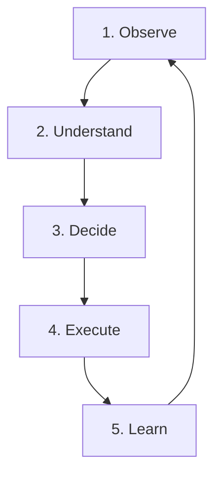

# 🏛️ Twin Doctrine — Autonomous Business Execution Layer

> **Key Definition:** **Twin = Autonomous Business Execution Layer for the One Person Company (OPC).**

---

## 🧭 Strategic Hierarchy

```
ShothikGPT            ──>  Unified AI Platform
  └── Twin            ──>  Business Execution Engine
        └── OPC       ──>  Business Model & Philosophy
              └── Specialized Twins  ──>  Functional AI Workers
```
* **Continuous Operational Pulse:** **Observe $\longrightarrow$ Understand $\longrightarrow$ Decide $\longrightarrow$ Execute $\longrightarrow$ Learn**

---

## ⚡ The ShothikGPT Ecosystem Triad

* ✍️ **Writing Suite:** Improve, transform, and polish written work.
* 🎨 **Creative Studio:** Create substantial intellectual and creative assets.
* 🏛️ **Twin:** Execute, automate, and scale business operations.

---

## ⚓ The Anchor Definition

> **"Twin is the system that coordinates work across people, tools, and AI agents to execute business operations."**

Twin is **never** merely "another AI agent." Its defining property is the **orchestration of business execution across functions, tools, people, and agents**.

* **Twin is not a chatbot.**
* **Twin is not a writing assistant.**
* **Twin is not a CRM.**
* **Twin is the system that coordinates work across people, tools, and AI agents to execute business operations.**

---

## Mission

**Reduce the operational workload required to run a business.**

Twin allows founders, freelancers, agencies, creators, and small businesses to focus on decisions while routine execution is delegated to AI.

The objective is not to replace business owners.  
**The objective is to multiply their capacity.**

---

## The OPC Philosophy

Every business requires recurring work across multiple functions:

* **Marketing**
* **Sales**
* **Customer Support**
* **CRM**
* **Finance & Cashflow**
* **Operations & Logistics**
* **Content & Social**
* **Analytics & Reporting**
* **Administration**

Traditionally, each function requires dedicated personnel.

Twin transforms these functions into **specialized AI workers coordinated by a single operating layer**.

A founder who previously needed multiple employees can instead manage a network of AI agents, reviewing outputs, approving important decisions, and intervening only where human judgment adds value.

---

## Operating Model

Twin follows a continuous operational cycle:



1. **Observe**
   * Collect signals from connected systems such as websites, CRM platforms, analytics, social channels, and communication tools.
2. **Understand**
   * Interpret business performance, identify trends, detect anomalies, and establish priorities.
3. **Decide**
   * Generate recommendations, rank opportunities, and prepare execution plans based on predefined goals and business context.
4. **Execute**
   * Carry out approved tasks through specialized agents, including content creation, outreach, workflow automation, reporting, and operational actions.
5. **Learn**
   * Record outcomes, refine future recommendations, and improve workflows over time.

This cycle runs continuously, creating a **persistent operational system** rather than isolated AI interactions.

---

## Specialized Business Twins

Twin is composed of role-specific operational agents, including but not limited to:

* 🎯 **Marketing Twin:** Campaign planning, ad creatives, growth loops, and channel attribution.
* 🔎 **SEO Twin:** Keyword gap analysis, metadata indexing, sitemap generation, and organic ranking.
* 💼 **Sales Twin:** Lead qualification, pipeline nurturing, follow-ups, and meeting booking.
* 📇 **CRM Twin:** Customer context vault, interaction history, lead tagging, and lifecycle stages.
* ✍️ **Content Twin:** Brand voice adaptation, multi-platform publishing (X, LinkedIn, Facebook).
* 🌐 **Website Twin:** Storefront management, landing page updates, and live conversion telemetry.
* 📈 **Analytics Twin:** Unit economics, CAC/LTV tracking, cohort retention, and margin dashboards.
* 🎧 **Customer Support Twin:** Multilingual 1-tap resolution, regional dialect handling, and ticket triaging.
* 📦 **Operations Twin:** Logistics booking (Steadfast/Pathao), bKash reconciliation, and Nilkhet POD dispatch.

Each Twin owns a defined responsibility, while collaborating through a shared orchestration layer.

---

## Human Control & Supervised Autonomy

Twin is designed around **supervised autonomy**.

### It may:
* Automate routine tasks,
* Prepare decisions,
* Coordinate workflows,
* Monitor business health, and
* Execute approved processes.

### Human Authority Boundary:
* **Strategic direction**,
* **Financial commitments & disbursements**,
* **Legal obligations**, and
* Other high-impact decisions remain strictly under human authority.

The goal is **AI-assisted execution**, not unsupervised control.

---

## Relationship to ShothikGPT

Twin is the operational engine of the ShothikGPT ecosystem.

* **The Writing Suite** produces communication.
* **The Creative Studio** produces intellectual and creative assets.
* **Twin transforms those outputs into business execution** by integrating them into workflows, automations, and operational processes.

---

## Doctrine Statement

> **Twin is the autonomous business execution platform within ShothikGPT. It empowers the One Person Company by coordinating specialized AI agents that observe, understand, decide, execute, and learn across business operations. Its purpose is to increase a person's operational capacity, enabling individuals and small teams to perform at the scale of a much larger organization while maintaining human oversight.**
