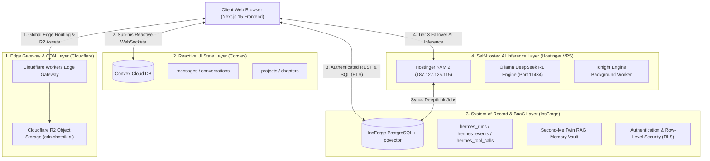

# 🏗️ Shothik & Hermes Official Multi-Layer System Architecture

Official architectural blueprint and system specification for **Shothik Web** and **Hermes Multi-Surface Autonomous AI Platform**.

---

## System Topology & Data Flow



---

## 🧩 Architectural Layer Breakdown

| Layer | Technology | Primary Responsibility | Endpoint / Resource |
|---|---|---|---|
| **1. Edge CDN & Gateway** | Cloudflare Workers + Cloudflare R2 | Global rate limiting, zero-egress asset CDN streaming, and multi-tier API routing. | `https://cdn.shothik.ai` |
| **2. Reactive UI State** | Convex Cloud | Sub-millisecond reactive subscriptions, live chat streaming, optimistic UI updates, writing studio drafts. | `https://dashing-mandrill-233.convex.cloud` |
| **3. System-of-Record BaaS** | InsForge PostgreSQL + `pgvector` | RAG vector embedding vault, tool execution audit logging (`public.hermes_tool_calls`), RLS security, and static storage. | `https://ers8j28a.ap-southeast.insforge.app` |
| **4. Self-Hosted AI Engine** | Hostinger KVM VPS + Ollama + Traefik | Tier 3 local DeepSeek R1 AI inference failover node and Tonight Engine background worker queue. | `http://187.127.125.115:11434` |

---

## 📊 Hermes Observability Pipeline

Every AI run in Hermes follows a standardized observability flow:

```
[Run Start] ➔ Insert into InsForge public.hermes_runs
    ↓
[Event Log] ➔ Append event to InsForge public.hermes_events
    ↓
[Tool Invocation] ➔ Execute tool via ToolBridge
    ↓
[Tool Audit] ➔ Record in InsForge public.hermes_tool_calls (id, runId, toolName, input, result, status)
    ↓
[UI Render] ➔ Stream response tokens & render DeerFlow / Swarm Visualizers in Convex Chat Stream
```

---

## 🔐 Security & Governance Model
* **Authentication**: InsForge JWT Access Tokens & Bearer Header Resolution (`lib/server-auth.ts`).
* **Data Isolation**: PostgreSQL Row-Level Security (RLS) policies per user ID.
* **Failover Tiering**:
  * **Tier 1**: Nous / OpenRouter AI Gateway.
  * **Tier 2**: InsForge AI Model Gateway.
  * **Tier 3**: Self-Hosted Hostinger VPS Ollama DeepSeek Node.
