# 🏆 Shothik AI Workspace — Ground Truth Document

**Document Identifier**: `docs/GROUND_TRUTH.md`  
**System**: Shothik AI Web Platform (`shothik-web`)  
**Orchestration Core**: Hermes Multi-Surface Autonomous AI Platform  
**Version**: 2.5.0 Production Baseline  

---

## 1. Single Source of Truth Architecture

```mermaid
graph TD
    Client["Client Browser (Next.js 15 App)"]
    
    subgraph "Identity & Storage Vault (InsForge)"
        InsForgeAuth["InsForge Auth & JWT Tokens (Primary Identity Source of Truth)"]
        InsForgeDB["InsForge PostgreSQL (hermes_runs, hermes_tool_calls, RLS)"]
        RagVectorVault["pgvector Twin RAG Memory Vault"]
        StorageCDN["Cloudflare R2 + InsForge Storage Buckets"]
    end
    
    subgraph "Reactive UI & Application State (Convex)"
        ConvexEngine[("Convex Cloud Functions & DB")]
        ChatMessages["messages & conversations (Live Subscriptions)"]
        StudioProjects["projects, chapters & books"]
    end
    
    subgraph "Self-Hosted DeepThink Engine (Hostinger VPS)"
        VPSNode["Hostinger KVM 2 Ubuntu (187.127.125.115)"]
        OllamaLocal["Ollama DeepSeek R1 Model (Port 11434)"]
        TonightWorker["Tonight Engine Background Worker"]
    end

    Client <-->|"Identity & Storage"| InsForgeAuth
    Client <-->|"Realtime Reactive State"| ConvexEngine
    Client <-->|"Tier 3 AI Inference"| VPSNode
```

---

## 2. Definitive Sources of Truth Matrix

| Domain / Subsystem | Primary Source of Truth | Secondary / Cache Layer | Authority File / Schema |
|---|---|---|---|
| **User Identity & Auth** | **InsForge BaaS** | Browser JWT Cookies / Bearer Header | [`lib/server-auth.ts`](file:///c:/Users/USER/hermes/shothik-web-mirror-v2/lib/server-auth.ts) |
| **Reactive UI Chat State** | **Convex Cloud DB** | Local Draft History (`localStorage`) | [`convex/schema.ts`](file:///c:/Users/USER/hermes/shothik-web-mirror-v2/convex/schema.ts#L594-L680) |
| **Hermes Observability Audit** | **InsForge PostgreSQL** | Memory Logs | `public.hermes_tool_calls`, `public.hermes_runs` |
| **RAG Vector Memory** | **InsForge `pgvector`** | Local Memory Service | [`lib/insforge/rag-memory.ts`](file:///c:/Users/USER/hermes/shothik-web-mirror-v2/lib/insforge/rag-memory.ts) |
| **Asset Storage & CDN** | **Cloudflare R2** | InsForge Storage Bucket Fallback | [`lib/cloudflare/r2-adapter.ts`](file:///c:/Users/USER/hermes/shothik-web-mirror-v2/lib/cloudflare/r2-adapter.ts) |
| **Overnight DeepThink Jobs** | **Hostinger VPS** | OpenRouter AI Gateway | [`lib/tonight-engine/llm-overnight-client.ts`](file:///c:/Users/USER/hermes/shothik-web-mirror-v2/lib/tonight-engine/llm-overnight-client.ts) |

---

## 3. Core Product Surfaces & Capabilities

1. **Chat Super Agent**: Live reasoning DAGs, DeepSeek R1 loops, Swarm visualizers.
2. **Chat-To-Slides**: Presentation slide generation (`HermesSlidesOrchestrator`).
3. **Chat-To-Sheets**: Formula & spreadsheet data calculations (`HermesSheetsOrchestrator`).
4. **Deep Research & Citations**: Academic paper retrieval (PubMed, bioRxiv, OpenAlex).
5. **Writing Tools**: Paraphraser, Grammar Checker, Summarizer, Polyglot Translator.
6. **Book Write-To-Publish**: Chapter outlines, manuscript authoring, PublishDrive distribution.
7. **Second-Me Twin**: AI persona tuning, `pgvector` memory indexing, key custody.
8. **AI Content Detector**: Scans text for AI patterns with confidence scores.
9. **Plagiarism Checker**: Web-wide similarity breakdown and source matching.
10. **Community & Forums**: Peer reviews, reservation badges, voting modes.
11. **Marketplace & Payouts**: Star transactions, Stripe connect, bKash/MFS payouts.
12. **Tonight Engine**: Overnight deepthink background worker queue.

---

## 4. Ground Truth Rules & Governance

* **R1 Model Routing**: All complex reasoning tasks default to DeepSeek R1 models with Hostinger VPS failover (`http://187.127.125.115:11434`).
* **Tool Audit Logging**: Every tool execution via `ToolBridge` **must** insert a record into `public.hermes_tool_calls` in InsForge PostgreSQL.
* **Vitest Coverage Threshold**: Codebase enforces **100% line, function, and statement coverage** with **98% branch coverage**.
* **Zero Egress Storage**: Static assets stream through Cloudflare R2 (`cdn.shothik.ai`) with InsForge storage fallback.
