# 🏆 Shothik AI Workspace — Ground Truth Document

> **Document Identifier**: `docs/GROUND_TRUTH.md`  
> **System**: Shothik Autonomous Operating System (`shothik-web`)  
> **Orchestration Core**: Hermes Multi-Surface Autonomous AI Platform  
> **Version**: 2.6.0 Production Baseline  
> **Last Verified**: August 2026  

---

## 1. Single Source of Truth Architecture

```mermaid
graph TD
    Client["Client Browser (Next.js 15 App :5000)"]
    
    subgraph "Identity & Storage Vault (InsForge)"
        InsForgeAuth["InsForge Auth & JWT Tokens (Primary Identity Source of Truth)"]
        InsForgeDB["InsForge PostgreSQL (hermes_runs, hermes_tool_calls, RLS)"]
        RagVectorVault["pgvector Twin RAG Memory Vault"]
        StorageCDN["Cloudflare R2 + InsForge Storage Buckets"]
    end
    
    subgraph "Ingress API Gateway & Commerce (:8080)"
        ApiGateway["Express / Zod API Gateway"]
        MfsEngine["bKash / Nagad 3-Layer TrxID Verification"]
        CourierEngine["Steadfast Courier 1-Click Booking"]
        MeshDispatcher["5-Tier Model Mesh Dispatcher"]
        BoiMelaEngine["HarfBuzz 6x9 Trade Book PDF Compiler"]
    end
    
    subgraph "Self-Hosted DeepThink & Local GPU Inference"
        LocalGPU["Intel Arc B580 11.8GB GPU (Ollama Port 11434)"]
        QwenCoder["Qwen2.5-Coder:7b Local Fast Engine (30 tok/s)"]
        HostingerVPS["Hostinger KVM 2 Colibri VPS (187.127.125.115)"]
        TonightWorker["Tonight Engine Background Batch Worker"]
    end

    subgraph "Trust, Voice & Social Ecosystem"
        LoomfeedCommunity["Loomfeed Web Community (Port 3001)"]
        RvcVoice["RVC Bengali Voice Synthesis (Port 8000)"]
    end

    Client <-->|"Identity & Storage"| InsForgeAuth
    Client <-->|"Commerce, Logistics & Mesh"| ApiGateway
    Client <-->|"Local Fast Coding / Chat"| LocalGPU
    Client <-->|"Voice Synthesis"| RvcVoice
    Client <-->|"Community & Truth Badges"| LoomfeedCommunity
```

---

## 2. Definitive Sources of Truth Matrix

| Domain / Subsystem | Primary Source of Truth | Secondary / Cache Layer | Authority File / Schema |
|---|---|---|---|
| **User Identity & Auth** | **InsForge BaaS** | Browser JWT Cookies / Bearer Header | [`lib/server-auth.ts`](file:///c:/Users/USER/hermes/shothik-web-mirror-v2/lib/server-auth.ts) |
| **API Ingress Gateway** | **API Server (`:8080`)** | Express / Zod Route Handlers | [`artifacts/api-server/src/routes/`](file:///c:/Users/USER/hermes/shothik-web-mirror-v2/artifacts/api-server/src/routes/) |
| **MFS & Logistics Contracts** | **Hermes Zod Contracts** | `@workspace/hermes` | [`lib/hermes/contracts/`](file:///c:/Users/USER/hermes/shothik-web-mirror-v2/lib/hermes/contracts/) |
| **RAG Vector Memory** | **InsForge `pgvector`** | Local Memory Service | [`lib/insforge/rag-memory.ts`](file:///c:/Users/USER/hermes/shothik-web-mirror-v2/lib/insforge/rag-memory.ts) |
| **Local GPU Inference** | **Ollama (`:11434`)** | `qwen2.5-coder:7b` GGUF | `http://127.0.0.1:11434` |
| **Community & Provenance** | **Loomfeed (`:3001`)** | Epistemic Provenance Badges | [`artifacts/shothik/src/components/chat/EpistemicProvenanceBadge.tsx`](file:///c:/Users/USER/hermes/shothik-web-mirror-v2/artifacts/shothik/src/components/chat/EpistemicProvenanceBadge.tsx) |
| **Commerce Action Stream** | **`CommerceActionCard.tsx`** | Steadfast API Gateway Integration | [`artifacts/shothik/src/components/chat/CommerceActionCard.tsx`](file:///c:/Users/USER/hermes/shothik-web-mirror-v2/artifacts/shothik/src/components/chat/CommerceActionCard.tsx) |
| **Overnight DeepThink Jobs** | **Hostinger VPS** | OpenRouter AI Gateway | [`lib/tonight-engine/llm-overnight-client.ts`](file:///c:/Users/USER/hermes/shothik-web-mirror-v2/lib/tonight-engine/llm-overnight-client.ts) |

---

## 3. Active Port Topology & Microservice Map

| Port | Service | Tech Stack | Status |
| :--- | :--- | :--- | :--- |
| **5000** | Shothik Web App | Next.js 15 / React 19 | 🟢 Active |
| **8080** | API Ingress Gateway | Node.js / Express / Zod | 🟢 Active |
| **3001** | Loomfeed Social Network | Next.js 15 / Go Gin | 🟢 Active |
| **8000** | RVC Bengali Voice Engine | Python FastAPI / PyTorch | 🟢 Active |
| **11434**| Ollama Local GPU Engine | Intel Arc B580 / Qwen2.5-Coder | 🟢 Active |
| **5432** | InsForge PostgreSQL BaaS | PostgreSQL 16 + pgvector + RLS | 🟢 Active |

---

## 4. Test Verification Benchmark

* **API Gateway Tests**: 22/22 Passing (100%)
* **Shothik Core Test Suite**: 1362/1362 Passing across 251 suites (100%)
* **Git Repository Status**: Synchronized with [`https://github.com/ahsanhab919-ux/shothik-opc-v2.git`](https://github.com/ahsanhab919-ux/shothik-opc-v2.git) (`main` branch)
