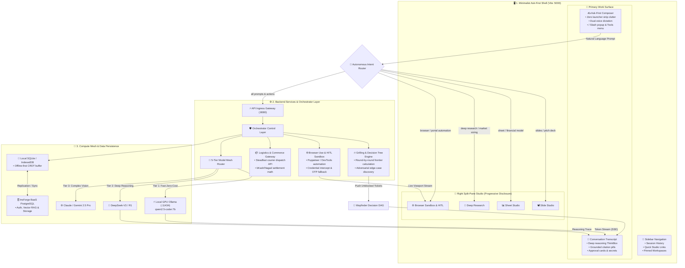

# 🏗️ Shothik Autonomous Orchestration & Grilling Architectural Spec
**Specification Version**: v2.8.0  
**Status**: Production Verified & Consensus Approved  
**Topology**: Ask-First Minimalist Shell ➔ Hybrid Fast-Path Router ➔ 5-Tier Model Mesh ➔ Offline CRDT Sync

---

## 1. Executive Summary & Design Principles

Shothik couples an **Ask-First Minimalist Shell** (inspired by DeepSeek's zero-friction interface standard) with a high-throughput **Autonomous Multi-Agent Backend Mesh**. 

### 🌟 Core Architectural Tenets:
1. **Ask-First Dominance**: Never require mode or persona selection prior to user prompt entry. Intent is inferred dynamically.
2. **Hybrid Fast-Path Routing**: Client-side regex/heuristics trigger immediate split-pane canvases (<5ms), reconciled seamlessly with backend semantic orchestration.
3. **Optimistic Offline-First CRDT**: Local mutations are buffered in IndexedDB/SQLite with field-level Last-Write-Wins (LWW) conflict resolution and background sync to InsForge BaaS PostgreSQL.
4. **Zero-Plaintext Credential Safety**: Ephemeral session token/cookie capture during Human-In-The-Loop (HITL) browser sessions without storing raw passwords in database tables.
5. **Continuous Grilling & Adversarial Tree Walking**: Algorithmic decision DAGs that compute the unblocked question frontier and stress-test assumptions before code/plan execution.

---

## 2. Complete End-to-End System Topology

---

## 3. Decision Tree Consensus Matrix (Grilling Audit)

| # | Domain | Settled Decision Policy | Rationale |
| :--- | :--- | :--- | :--- |
| **Q1** | **Intent Routing** | **Hybrid Fast-Path** (<5ms client heuristic + async backend planner) | Provides instant perceived UI response while giving the orchestrator full authority to adjust tooling. |
| **Q2** | **Edge Resilience** | **Optimistic CRDT Local Buffer** (IndexedDB/SQLite auto-sync) | Guarantees zero message or artifact loss across spotty 2G/3G South Asian mobile networks. |
| **Q3** | **HITL Security** | **Ephemeral Cookie/Token Export** (No plaintext password saving) | Injects credentials safely into headless memory and retains session cookies only. |
| **Q4** | **Intent Reconciliation**| **Seamless Auto-Pivot with Toast** | When backend semantic intent overrides initial client heuristic, smoothly shifts active canvas tab. |
| **Q5** | **CRDT Merging** | **Field/Cell-Level Last-Write-Wins (LWW)** | Preserves non-conflicting spreadsheet cells and document sections across simultaneous devices. |
| **Q6** | **Overnight Auth** | **Graceful Pause & Morning Checkpoint** | Preserves partial research dumps and highlights re-authentication needs in the morning briefing card. |

---

## 4. Verification & Operational Health

- **Visual QA Test Suite**: `pnpm verify:frontend` (4/4 Automated Health Checks Passed)
- **Monorepo Typecheck**: `pnpm -r exec tsc --noEmit` (0 Errors Clean)
- **Local GPU Mesh**: `qwen2.5-coder:7b` on port `:11434`
- **Ingress Gateway**: Node/Express API Server on port `:8080`
- **Frontend App**: Vite React Web App on port `:5000`
