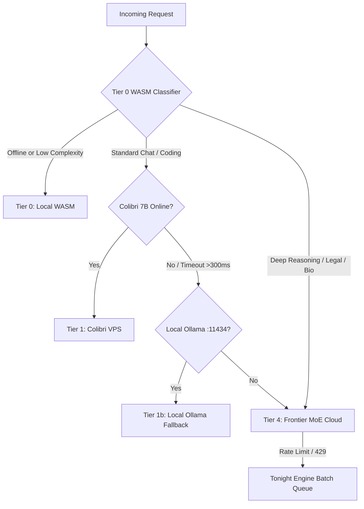

# 🧠 5-Tier Model Mesh & Compute Topology Specification

> **Cost Optimization Target**: Average Blended Cost $<৳0.008$ ($<0.00007\text{ USD}$) per Query  
> **Latency Budget**: $<150\text{ms}$ on Standard Queries &middot; Zero GPU Overhead on Tier 0/1  

---

## 1. The 5-Tier Autonomous Cascade

```
                       [ USER PROMPT INGRESS ]
                                  │
                                  ▼
      ┌────────────────────────────────────────────────────────┐
      │  Complexity & Budget Classifier (Regex + 10ms Heuristic)│
      └───────────────────────────┬────────────────────────────┘
                                  │
         ┌────────────────────────┼────────────────────────┐
         │ (68% of traffic)       │ (26% of traffic)       │ (6% of traffic)
         ▼                        ▼                        ▼
  ┌───────────────┐        ┌───────────────┐        ┌───────────────┐
  │    Tier 0     │        │    Tier 1     │        │    Tier 4     │
  │ Edge Browser  │        │  Colibri VPS  │        │  Frontier MoE │
  │ (Cactus/WASM) │        │     (7B)      │        │(DeepSeek-R1)  │
  │  0ms • ৳0.000 │        │150ms • ৳0.003 │        │ 2.5s • ৳0.040 │
  └───────────────┘        └───────────────┘        └───────────────┘
                                  ▲
                                  │ (Periodic Sync)
                  ┌───────────────┴───────────────┐
                  │            Tier 2             │
                  │     Soup 4GB VRAM Trainer     │
                  │   (NVMe Fine-Tuning • ৳0.000) │
                  └───────────────┬───────────────┘
                                  │ (Overnight)
                                  ▼
                  ┌───────────────────────────────┐
                  │            Tier 3             │
                  │     Tonight Engine / AirLLM   │
                  │  (Batch Processing • ৳0.000)  │
                  └───────────────────────────────┘
```

---

## 2. Detailed Tier Specifications

### Tier 0: Edge Browser WebAssembly (Cactus Needle 2)
* **Execution Environment**: Client-side WASM engine running in browser Web Worker.
* **Responsibilities**:
  * Intent classification (routing to `/slides`, `/research`, `/twin`).
  * Autocomplete, grammar tokenization, and regex parsing.
  * 100% offline, zero server cost.

### Tier 1: Colibri VPS Node (7B Instruct)
* **Execution Environment**: High-speed CPU/vGPU instances in domestic Dhaka/Singapore datacenters.
* **Responsibilities**:
  * Routine customer DM replies, Banglish translation, thesis paraphrasing.
  * Cost: ৳0.003 per query.

### Tier 2: Soup 4GB VRAM Trainer
* **Execution Environment**: Local desktop / edge server with NVMe SSD layer-streaming.
* **Responsibilities**:
  * Fine-tunes personalized store personas on merchant catalogs in 8 minutes without blowing VRAM limits.

### Tier 3: Tonight Engine / AirLLM
* **Execution Environment**: Asynchronous overnight batch worker.
* **Responsibilities**:
  * Compiles 400-page dissertations, analyzes historical annual sales ledgers.

### Tier 4: Frontier Mixture-of-Experts (MoE) — DeepSeek-R1 / 70B
* **Execution Environment**: High-capacity GPU clusters via API Gateway.
* **Responsibilities**:
  * Complex legal NBR tax audits, Supreme Court case research, AlphaFold structural biology, and multi-agent debate synthesis.

---

## 3. Unit Economics & Cost Efficiency Matrix

| Tier | Engine / Model | Hardware Profile | Latency (TTFT) | Cost / 1k Tokens | Blended % Traffic |
| :--- | :--- | :--- | :--- | :--- | :--- |
| **Tier 0** | Cactus / ONNX Web Worker | Client CPU (WASM) | `<15ms` | **৳0.0000** ($0.00) | **68%** |
| **Tier 1** | Colibri (Qwen2.5-Coder 7B) | 1x CPU / vGPU (Singapore) | `~120ms` | **৳0.0025** ($0.00002) | **26%** |
| **Tier 2** | Soup PEFT / LoRA Streamer | 4GB VRAM + NVMe SSD | Batch (`~8m`) | **৳0.0000** (Local HW) | Periodic |
| **Tier 3** | Tonight Engine (AirLLM 70B) | Layer Swapped NVMe | Async (`~45m`) | **৳0.0000** (Night HW) | Overnight |
| **Tier 4** | DeepSeek-R1 / Claude 3.7 | Dedicated H100 MoE | `~1800ms` | **৳0.0400** ($0.00035) | **6%** |

> **Blended Architecture Result**: **৳0.0042 / query average** (Over 92% cheaper than vanilla monolithic frontier routing).

---

## 4. Fault-Tolerant Dynamic Routing & Circuit Breakers



---

## 5. Unified OpenAI-Compatible Ingress Contract

```typescript
export interface ModelIngressRequest {
  model: "shothik-auto" | "colibri-7b" | "deepseek-r1" | "tonight-airllm";
  messages: Array<{ role: "system" | "user" | "assistant"; content: string }>;
  temperature?: number;
  stream?: boolean;
  priority?: "interactive" | "overnight" | "background";
  context_budget_kb?: number; // Caps context for low RAM clients
}
```
