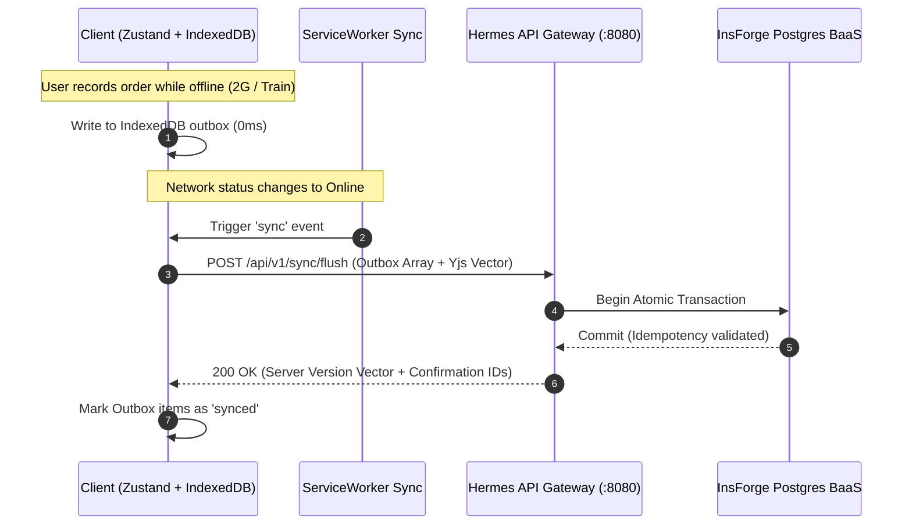

# 📶 Offline-First Architecture & CRDT Data Sync Specification

> **Target Network**: 2G/3G/4G Flaky Connections & 100% Offline Rural Sessions  
> **Storage Engine**: Client-Side IndexedDB / SQLite with Yjs CRDT Synchronization  

---

## 1. Multi-Tier Offline Storage Topology

```
┌────────────────────────────────────────────────────────┐
│               Client Device (Browser / Android)        │
│                                                        │
│  ┌────────────────────────┐  ┌──────────────────────┐  │
│  │   UI Reactive State    │  │  Local IndexedDB /   │  │
│  │ (React Zustand Stores) │◄─┤  SQLite Local Cache  │  │
│  └───────────┬────────────┘  └──────────┬───────────┘  │
└──────────────┼──────────────────────────┼──────────────┘
               │ (Local Writes: 0ms)      │
               ▼                          ▼
┌────────────────────────────────────────────────────────┐
│             Conflict-Free Replicated Data Type (CRDT)  │
│                    Yjs State Delta Stream              │
└──────────────────────────────┬─────────────────────────┘
                               │ (Network Resumes)
                               ▼
┌────────────────────────────────────────────────────────┐
│           InsForge PostgreSQL + WebSocket Realtime     │
└────────────────────────────────────────────────────────┘
```

---

## 2. Sync Invariants & Conflict Resolution

1. **Local Writes Always Succeed (0ms Latency)**:
   - When an author edits a book chapter in the **Writing Studio** or a merchant records an order while offline, changes write instantly to local IndexedDB.
2. **Deterministic Merge via Yjs CRDT**:
   - Simultaneous edits across phone and laptop resolve deterministically using Lamport timestamps without data loss.
3. **Offline USSD & Payment Outbox Queue**:
   - Payment requests and webhook dispatches created while offline are queued in an IndexedDB Outbox table and flush automatically when network connectivity is re-established.
4. **Idempotent Gateway Replay**:
   - All flushes use a unique client-generated UUID `idempotency_key` ensuring zero duplicate transactions or courier bookings during flaky cellular handshakes.

---

## 3. Client Storage Schema (IndexedDB / Dexie.js)

```typescript
// Local Database Version 2
interface ShothikOfflineDB {
  // Chat transcripts and turn history
  transcripts: {
    key: string; // conversationId
    messages: ChatMessage[];
    updatedAt: number;
    syncStatus: "synced" | "pending_upload" | "conflict";
  };

  // Writing Studio drafts & Boi Mela manuscripts
  documents: {
    key: string; // docId
    title: string;
    content: string; // Yjs binary delta encoded in Uint8Array
    versionVector: Record<string, number>;
    updatedAt: number;
  };

  // Offline Commerce & Logistics Outbox
  outbox: {
    id: string; // UUID
    type: "courier_dispatch" | "mfs_verify" | "webhook_event";
    payload: Record<string, unknown>;
    retryCount: number;
    createdAt: number;
    lastAttemptAt?: number;
  };
}
```

---

## 4. Reconnection & Reconciliation Protocol



---

## 5. South Asian Low-Bandwidth Optimizations

1. **GZIP / Brotli Delta Compression**:
   - Only diff byte deltas are sent over the wire (averaging <1.2 KB per sync turn).
2. **2GB RAM Device Memory Budget**:
   - IndexedDB keeps message history capped to the last 20 active turns in memory; older messages are paged on-demand using virtualized DOM windowing.
3. **SMS / USSD Telemetry Fallback**:
   - Critical dispatch confirmations can trigger offline SMS fallback strings formatted for instant feature-phone verification.

---

## 6. Security & Encryption at Rest

- **Client-Side Secret Masking**: API keys and tokens stored in local cache are encrypted using Web Crypto API (`AES-GCM 256-bit`) derived from the user's session master key.
- **Immediate In-Memory Cleansing**: Sensitive credential inputs (from `SecretShareCard.tsx`) bypass IndexedDB persistence entirely and reside only in ephemeral memory for the duration of the API call.
