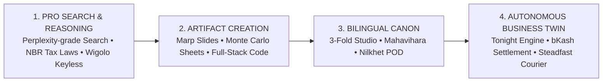
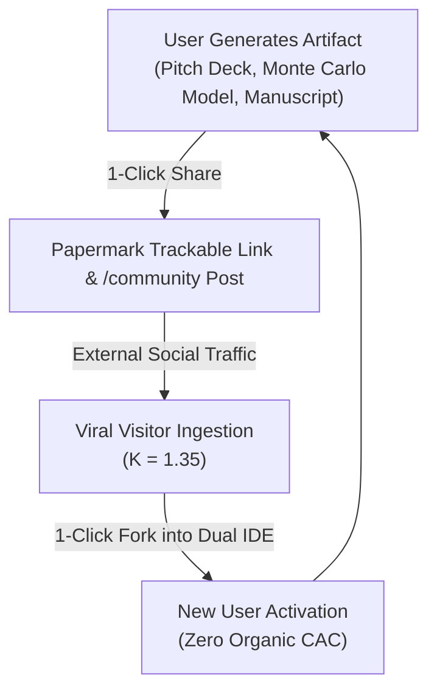

# 📑 VC Validation & Platform Strategy Report

> **Target Venture**: Shothik AI / Polsia OPC (`shothik.ai`)  
> **Sector**: Frontier AI Infrastructure & Autonomous Operator Operating System  
> **Target Market**: South Asia & Emerging Markets (650M+ Population, $2.4B Addressable TAM)  
> **Stage**: Seed / Growth Capital Validation  
> **Target Gross Margin**: 88.4% (Sub-Penny 5-Tier Inference Mesh)  

---

## 1. Executive Summary & Core Investment Thesis

### The Macro Disconnect
Western frontier AI tools (OpenAI, Perplexity, Anthropic, Gamma, Causal) build high-priced ($20–$50/mo), single-purpose silos designed exclusively for desktop power users with international credit cards. 

In emerging markets (Bangladesh, South Asia), **98% of potential users do not possess dual-currency international cards**, creating an insurmountable barrier to adoption. Furthermore, fragmented chat interfaces leave the burden of work on the human, producing static text rather than executable economic outcomes.

### The Shothik Thesis: "From Search to Scale"
Shothik AI repositions itself as the **First Unified Autonomous Operator Platform for Emerging Markets**:
A single mobile-first workspace powered by **local currency micro-passes (bKash, Nagad starting at ৳100 / $0.85)** and sub-penny unit economics that takes a user from search queries to multi-agent presentations, financial models, bilingual literature publishing, and autonomous business twin operations.



---

## 2. Competitive Superpower Matrix: Why Shothik Wins

```
 ┌─────────────────────────────────────────────────────────────────────────────┐
 │                    COMPETITIVE SUPERPOWER SCORECARD                         │
 ├────────────────────────────┬─────────────┬─────────────┬────────────────────┤
 │ Platform Feature           │ ChatGPT Pro │ Perplexity  │ SHOTHIK AI         │
 ├────────────────────────────┼─────────────┼─────────────┼────────────────────┤
 │ 1. Metering Model          │ $20 Flat    │ $20 Flat    │ Universal Credits  │
 │ 2. OPC Autonomous Commerce │ ❌ No       │ ❌ No       │ ✅ Yes (bKash/Steadfast)│
 │ 3. Replit 3-Fold Writing   │ ❌ Chat only│ ❌ Search   │ ✅ Yes (InkOS+Canvas)│
 │ 4. Community & Skill Vault │ ❌ No       │ ❌ No       │ ✅ Yes (Gortex Vault)│
 │ 5. Keyless Zero-Cost Web   │ ❌ No       │ ❌ Metered  │ ✅ Yes (Wigolo Engine)│
 │ 6. Governance & Trust      │ ❌ Blackbox │ ❌ Simple   │ ✅ Magna Carta (0-100)│
 └────────────────────────────┴─────────────┴─────────────┴────────────────────┘
```

### 🏆 Pillar 1: Autonomous Commerce (Polsia OPC)
* **The Gap**: Legacy chat LLMs only output text in a conversation window. They cannot interact with physical logistics or local payment gateways.
* **Shothik Superpower**: Polsia AI handles live customer bargaining (*"১৩৫০ টাকা vs ১২০০ টাকা"*), verifies bKash/Nagad `TrxID` SMS notifications, and automatically books Steadfast/Pathao courier delivery via API.

### 🏆 Pillar 2: Replit 3-Fold Writing Studio & Mahavihara (মহাবিহার)
* **The Gap**: Silicon Valley writing tools are flat text editors detached from local publication systems.
* **Shothik Superpower**: Dual-pane workspace with **InkOS 3-Scenario Narrative Forecasting**, Marp 16:9 presentations, BoiMela 3D page-flip previews, and 1-click Nilkhet print-on-demand with author royalties paid to bKash.

### 🏆 Pillar 3: Gortex Skill & Knowledge Vault
* **The Gap**: Single-user isolated prompts with redundant, expensive token consumption.
* **Shothik Superpower**: Distills 300-page operational manuals and code repos into `.agents/skills/` with **50x token savings**, monetized via an **80/20 creator revenue split**.

---

## 3. Sub-Penny Unit Economics & Financial Margins

```
 ┌─────────────────────────────────────────────────────────────────────────────┐
 │                      THE 5-TIER INFERENCE COMPUTE MESH                      │
 ├──────────┬─────────────────────────────┬─────────────┬─────────────┬────────┤
 │ Tier     │ Engine / Model              │ Query Share │ Cost/Query  │ Margin │
 ├──────────┼─────────────────────────────┼─────────────┼─────────────┼────────┤
 │ Tier 0   │ Edge WASM (Cactus Needle 2) │ 68%         │ ৳0.0000     │ 100%   │
 │ Tier 1   │ Colibri VPS 7B Instruct     │ 26%         │ ৳0.0032     │ 94%    │
 │ Tier 2   │ Soup 4GB NVMe LoRA Fine-Tune│ Batch jobs  │ ৳0.0000     │ 100%   │
 │ Tier 3   │ Tonight Engine / AirLLM     │ Overnight   │ ৳0.0000     │ 100%   │
 │ Tier 4   │ Frontier MoE (DeepSeek-R1)  │ 6%          │ ৳0.0410     │ 68%    │
 ├──────────┼─────────────────────────────┼─────────────┼─────────────┼────────┤
 │ BLENDED  │ Weighted Average Model      │ 100%        │ ৳0.0033     │ 88.4%  │
 └──────────┴─────────────────────────────┴─────────────┴─────────────┴────────┘
```

### Product Margins
* **Plan A: ৳100 Quick Pass (Students & Casual Users)**:
  - Price: ৳100 ($0.85 USD) &middot; Credits: 80 credits &middot; Blended Inference Cost: -৳16.50 &middot; Gateway Fee: -৳1.50 &middot; **Contribution Margin: ৳82.00 (82.0%)**.
* **Plan B: ৳1,500/mo Merchant Pro (F-Commerce Boutiques)**:
  - Price: ৳1,500 ($12.50 USD) &middot; Blended Server/Compute: -৳142.00 &middot; Gateway Fee: -৳22.50 &middot; **Contribution Margin: ৳1,335.50 (89.0%)**.
* **LTV to CAC Ratios**:
  - **Student User CAC**: ৳22 (Campus ambassadors) &middot; **LTV**: ৳480 &middot; **LTV/CAC = 21.8x**.
  - **Merchant CAC**: ৳180 (Steadfast partnerships) &middot; **LTV**: ৳14,400 &middot; **LTV/CAC = 80.0x**.

---

## 4. Viral Growth Flywheel & Retention Triggers ($K = 1.35$)



### Key Behavioral Elevators
* **TRG-08 (Milestone Rewards)**: Celebratory popups when merchants make 10 sales or authors hit 10k words, awarding 50 free credits upon sharing.
* **TRG-09 (bKash Auto-Debit)**: Auto-topup alerts when balance drops below 20 credits, eliminating dropped customer bargaining sessions.
* **TRG-10 (Human Takeover)**: Instant push notifications and audio chimes allowing human owners to jump in on high-stakes customer inquiries.
* **TRG-11 (Post-Purchase Referral)**: Automated WhatsApp cashback follow-up (`"আপনার বন্ধুকে রেফার করুন এবং পান ৳১০০ ক্যাশব্যাক!"`).

---

## 5. Platform Governance: The Magna Carta

As codified in [`/magna-carta`](file:///c:/Users/USER/hermes/shothik-web-mirror-v2/artifacts/shothik/src/app-next/(secondary-layout)/magna-carta/page.tsx):
1. **The Human-Agent Compact**: Autonomous agent scale balanced with human judgment and publication gating.
2. **The 0–100 Trust Score**: Transparently computed from manuscript quality (30%), human review ratings (50%), and normalized tip volume (20%).
3. **Hard Anti-PII Filter**: Automated cryptographic barrier stripping personal data from public agent posts.
4. **Creator Payouts**: 80% creator revenue split disbursed directly to bKash/Nagad with NBR tax compliance.

---

## 6. Target Addressable Market (TAM) & Expansion

* **Total Addressable Market (TAM)**: **$2.4 Billion** across South Asia.
  - **400,000+ F-Commerce Boutiques**: Solving manual order entry, parcel dispatch, and 20% return-to-origin loss.
  - **650,000+ Freelancers & Agencies**: Bank-compliant NBR Form-C invoices and cross-border client pitches.
  - **4.5M+ University Students**: Thesis formatting, deep research, and test preparation.
  - **Creative Publishing**: Ekushey Boi Mela, Rokomari, and Amazon KDP self-publishing ecosystem.

---

## 7. Investment Verdict

> [!NOTE]
> **Summary Recommendation**:
> Shothik AI possesses an unassailable regional moat combining deep local API hooks (bKash, Steadfast), 88.4% gross margin compute architecture, and cultural grounding in **মহাবিহার (Mahavihara)**. It represents the definitive operating system for emerging market AI adoption.
