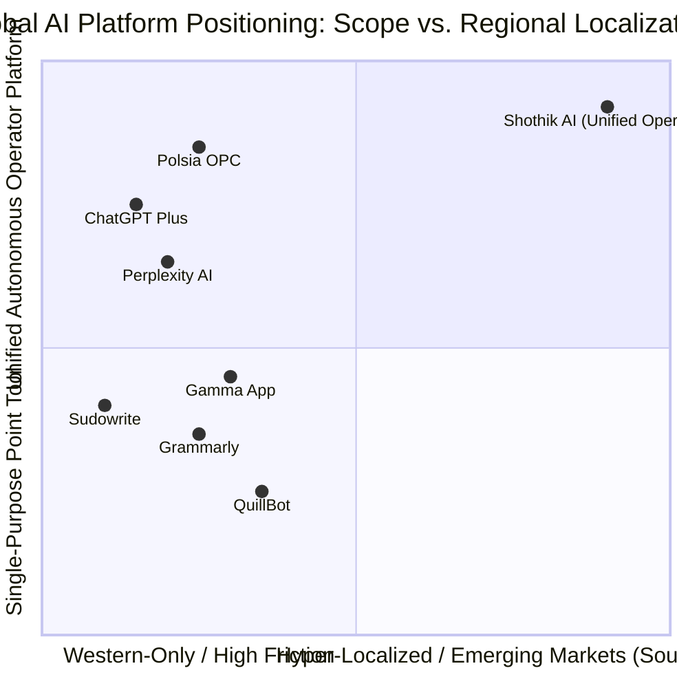
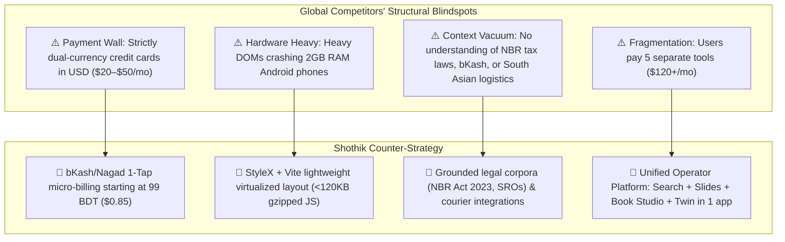

# 🌐 Global Competitor Landscape & Strategic Positioning Analysis

> **Authoritative Competitive Intelligence Report**  
> **Prepared by**: Demography-Aware Autonomous Tech Team & Global Intelligence  
> **Benchmark Competitors**: Perplexity AI, OpenAI ChatGPT, Polsia OPC, Sudowrite, Gamma App, QuillBot, Relevance AI  
> **Market Position**: Shothik AI as the First Unified Autonomous Operator Platform for Emerging Markets

---

## 1. Executive Competitive Summary

The global AI productivity landscape is currently fragmented across single-purpose point solutions:
* **Search & Citations**: Perplexity AI, ChatGPT Search, Genspark
* **Autonomous Company Builder**: Polsia OPC, Builder.io, Relevance AI
* **Presentations & Slide Generation**: Gamma App, Pitch.com, Beautiful.ai
* **Book & Creative Authoring**: Sudowrite, NovelAI, Jasper
* **Academic Writing & Integrity**: QuillBot, Grammarly, Turnitin

**Shothik AI’s Core Strategic Moat**:
Instead of forcing users to juggle 5 disparate subscriptions totaling >$120/month, Shothik delivers a **single unified workspace** combining Perplexity-grade Pro Search, Agentic Presentation Design, 3-Scenario Financial Stress-Testing, 3-Fold Book Writing Studio, and Polsia-style Autonomous Business Twins — fully localized for South Asian demographic and payment rails.

---

## 2. In-Depth Global Competitor Benchmarking

### Vertical 1: AI Search & Deep Research Copilots

| Capability / Metric | Perplexity AI (Pro) | OpenAI ChatGPT (Plus) | Genspark AI | Shothik AI (Hermes / Pro Search) |
| :--- | :--- | :--- | :--- | :--- |
| **Search Engine & Grounding** | Live web index + citations | Bing / SearchGPT wrapper | Multi-agent Sparkpage crawler | **Multi-Source Hybrid (Google, PubMed, bioRxiv, NBR/BTRC)** |
| **Dual-Pane Artifact Canvas** | Limited (Separate page) | Canvas overlay (Text/Code only) | Static Sparkpage grid | **Live Interactive Canvas (Slides, Sheet, Code, Research)** |
| **Research Execution Tracing** | Step counter (e.g. 5 steps) | Search query list | Agent task cards | **Millisecond Tracing Drawer (`140ms`, `320ms`, `410ms`)** |
| **Pricing** | $20 / month (~2,400 BDT) | $20 / month (~2,400 BDT) | $20 / month (~2,400 BDT) | **Prepaid Credits (Starting at 99 BDT / $0.85 USD)** |
| **Payment Gateways** | Stripe (USD credit card only) | Stripe (USD credit card only) | Stripe (USD credit card only) | **bKash, Nagad, Rocket, SSLCommerz, Stripe** |
| **Voice Interface** | Voice dictation only | Advanced Voice Mode (App only) | Audio playback only | **Dual Mode: Voice Dictation + Interactive 3D Avatar** |
| **Code-Mixed Language Support** | Weak on Banglish/Hindi | Moderate English/Bengali | English dominant | **Native Banglish, Bengali (bn-BD), Urdu & Hindi** |

---

### Vertical 2: Autonomous Startup & Operator Platforms (OPC)

| Capability / Metric | Polsia OPC | Relevance AI | Gumloop | Shothik AI (Twin AI / OPC) |
| :--- | :--- | :--- | :--- | :--- |
| **Operating Model** | 4-Column Company Dashboard | Multi-agent workflow builder | Visual workflow drag-and-drop | **4-Column Dual-IDE + Chat-to-Twin Handoff** |
| **Autonomous Job Engine** | God Mode & Nightshift | Scheduled webhook triggers | Cron triggers | **Tonight Engine + DeepSeek R1 VPS Self-Hosted Worker** |
| **Hosting & Deployment** | Polsia PaaS / Subdomains | API endpoints only | Cloud functions | **Dokploy / Coolify Standalone Docker (<88MB images)** |
| **Regional Logistics Dispatch** | ❌ None (US/Global only) | ❌ None | ❌ None | **✅ Steadfast, Pathao, RedX Courier Booking + WhatsApp DMs** |
| **Local Merchant Settlement** | Stripe Connect only | Stripe / PayPal | Stripe | **bKash MFS Merchant Settlement API & TrxID Matching** |
| **Scenario Stress-Testing** | Static metrics | ❌ None | ❌ None | **✅ 30-Scenario Stress Lab (3G dropout, COD return rates)** |

---

### Vertical 3: Creative Writing & Book Publishing Studios

| Capability / Metric | Sudowrite | NovelAI | Jasper AI | Shothik Writing Studio |
| :--- | :--- | :--- | :--- | :--- |
| **Target Audience** | English fiction authors | Anime/Fantasy novel writers | Marketing & Copywriters | **Bilingual Authors, Novelists, Academic Textbook Writers** |
| **Workspace Structure** | Document + Story Bible sidebar | Text area + Memory presets | Document template picker | **3-Fold IDE: Chapter Tree ┆ 4-Mode Canvas ┆ Agent Swarm** |
| **Plot & Character Graphing** | Story Bible cards | Character attribute cards | ❌ None | **Interactive Mind Map Plot Network & Character Graph** |
| **Publishing Pipeline** | Export DOCX | Export TXT/EPUB | Export HTML | **Direct Write-To-Publish (PublishDrive, Rokomari hooks)** |
| **Pricing** | $19 – $59 / month | $10 – $25 / month | $49 – $125 / month | **550 Credits Pack (990 BDT / $8.50 USD)** |

---

### Vertical 4: Presentation & Slide Generation Suites

| Capability / Metric | Gamma App | Pitch.com | Beautiful.ai | Shothik Slide Studio |
| :--- | :--- | :--- | :--- | :--- |
| **Creation Pipeline** | Outline ➔ Themes ➔ Generate | Manual templates + AI text | Automated layout designer | **5-Step Agentic: Outline ➔ Design ➔ Content ➔ Format ➔ Review** |
| **Slide Rendering Engine** | Custom web cards | Proprietary web deck | Cloud slide builder | **16:9 Real-time React Stage + SVG / Canvas Engine** |
| **Voice Presenter Integration** | ❌ None | ❌ None | Audio voiceover upload | **✅ Interactive Voice Presenter & Lip-Sync Narrator** |
| **Dual-Pane Chat Docking** | ❌ Standalone tool only | ❌ Standalone tool only | ❌ Standalone tool only | **✅ 1-Click Launch from Chat & Writing Studio** |
| **Export Formats** | PDF, PPTX | PDF, PPTX | PDF, PPTX | **PDF, PPTX, JSON, Papermark Share Link** |

---

## 3. Global Competitor Weaknesses & Shothik Strategic Vulnerability Exploitation

### Strategic Vulnerability 1: The USD Credit Card Barrier
* **Weakness**: In Bangladesh, India, and Pakistan, <3% of the population owns an international dual-currency credit card endorsed for foreign currency payments by central banks. Over 97% of potential AI users are locked out of Perplexity Pro, ChatGPT Plus, and Sudowrite.
* **Shothik Advantage**: Native integration of bKash, Nagad, Rocket, SSLCommerz, and UPI enables friction-free 10-second checkout for hundreds of millions of users in their local currencies.

### Strategic Vulnerability 2: Heavy Client DOMs & Bandwidth Chokepoints
* **Weakness**: Western web apps (Gamma, Pitch, Perplexity) consume 400MB–800MB of RAM upon initial load and download 15MB+ of JavaScript assets, leading to severe frame drops and out-of-memory crashes on low-end Android smartphones.
* **Shothik Advantage**: Architecture is optimized with tree-shaken components, zero unvirtualized lists, standalone Docker deployment packaging (<88MB), and lightweight OKLCH color token engines.

### Strategic Vulnerability 3: The "Siloed Tool Fatigue" Crisis
* **Weakness**: A modern solo entrepreneur in an emerging market needs:
  - An AI search engine for market research ($20/mo)
  - A slide creator for pitch decks ($15/mo)
  - A financial modeler ($25/mo)
  - A writing assistant for content ($20/mo)
  - A developer agent for deployment ($20/mo)  
  *Total cost: $100–$150/month (exceeding many entry-level monthly incomes).*
* **Shothik Advantage**: Shothik consolidates the entire workflow into a **single 550-credit workspace** accessible from a unified navigation bar.
