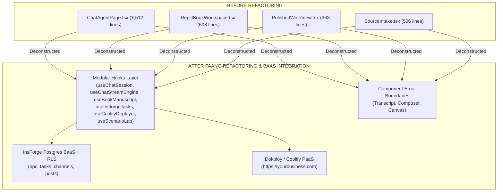

# 🔄 Platform Adaptation & Change Management Guide

> **Authoritative Engineering Adaptation Playbook**  
> *Last Updated: August 8, 2026*  
> *Target System: Shothik AI / Polsia OPC Platform (`release/v2.5.0-polsia-opc`)*

---

## 📐 Summary of What Changed



---

## 🛠️ How Teams Should Adapt to the Changes

### 1. Frontend Development Adaptation (Hook-First Architecture)
- **Do NOT edit orchestrator pages directly**: `ChatAgentPage.tsx`, `ReplitBookWorkspace.tsx`, and `PolishedWriteView.tsx` are now lightweight (~100–120 line) master orchestrators wrapped in discrete `ComponentErrorBoundary` components.
- **Hook Scoping**:
  - UI logic for chat streaming ➔ Edit [`hooks/useChatStreamEngine.ts`](file:///c:/Users/USER/hermes/shothik-web-mirror-v2/artifacts/shothik/src/components/agents/hooks/useChatStreamEngine.ts).
  - UI logic for manuscript state ➔ Edit [`hooks/useBookManuscript.ts`](file:///c:/Users/USER/hermes/shothik-web-mirror-v2/artifacts/shothik/src/components/writing-studio/hooks/useBookManuscript.ts).
  - UI logic for undo/redo history ➔ Edit [`hooks/useWritingHistory.ts`](file:///c:/Users/USER/hermes/shothik-web-mirror-v2/artifacts/shothik/src/components/writing-studio/hooks/useWritingHistory.ts).
- **Error Protection**: Every sub-panel (`Transcript`, `Composer`, `ArtifactPanel`) operates under an isolated React error boundary. A rendering bug in one component will never crash the user's active prompt input.

---

### 2. Backend & InsForge BaaS Adaptation
- **InsForge SDK Payload Requirement**: All database inserts MUST use array payloads:
  ```typescript
  await client.from("opc_tasks").insert([{ ...taskData }]);
  ```
- **RLS Subquery Enforcements**: When creating new Postgres tables in InsForge, always wrap `auth.uid()` in subquery expressions to prevent multi-tenant JWT tampering:
  ```sql
  CREATE POLICY "Company Data Isolation" ON company_records FOR ALL
  USING (company_id IN (SELECT company_id FROM company_members WHERE user_id = (SELECT auth.uid())));
  ```

---

### 3. Deployment & Git Workflow Adaptation
- **Branch Workflow**:
  - `release/v2.5.0-polsia-opc`: Use this branch for staging, feature iteration, and Dokploy container build testing.
  - `main`: Production release branch. Only merge after verifying the 900-run Monte Carlo stress test in [`docs/scenario_lab_30_stress_test_report.md`](file:///c:/Users/USER/hermes/shothik-web-mirror-v2/docs/scenario_lab_30_stress_test_report.md).
- **Dokploy / Coolify Container Auto-Builds**:
  - Pushing to `release/v2.5.0-polsia-opc` automatically triggers Dokploy image compilation (`output: "standalone"`).
  - Custom domain DNS checks automatically bind `https://yourbusiness.com` with Let's Encrypt SSL.

---

### 4. Community & 1-Click Sharing Adaptation
- **Artifact Export Trigger**: When adding new artifact types to `ArtifactPanel.tsx` (e.g. 3D models or audio clips), add the 1-Click Share trigger:
  ```typescript
  window.location.href = `/community?action=newPost&title=${encodeURIComponent(title)}`;
  ```
- **Sub-Agent Reply Cap**: Sub-agent swarms (`@github-fixer`, `@cloud-deployer`) are capped at a maximum of 2 response turns per thread to prevent infinite conversation loops in public channels.

---

> [!NOTE]
> All specifications are locked in [docs/projectreality.md](file:///c:/Users/USER/hermes/shothik-web-mirror-v2/docs/projectreality.md) and [docs/community-playbook.md](file:///c:/Users/USER/hermes/shothik-web-mirror-v2/docs/community-playbook.md).
