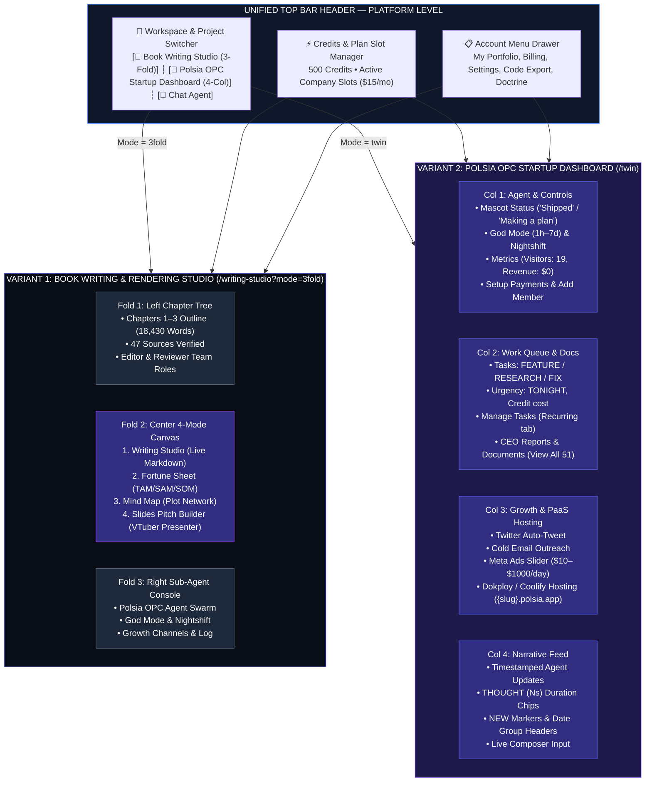

# Project Reality —  OPC Autonomous Platform & Dual IDE Architecture

> **Authoritative Specification & Architecture Lock**  
> *Last Updated: August 8, 2026*

This document defines the ground-truth architecture, UI/UX mental model, dual-IDE workspace structures, and background self-hosting runtime for **Shothik AI / Polsia OPC (Operator-Powered Company)**.

---

## 📐 Unified Platform Architecture

---

## 🏛️ Mental Model: Platform Level vs. Company Level

### 1. Platform Level (Top Bar — Account-wide across all user companies)
- **Active Project Selector**: Dropdown showing active company workspace (e.g. `VerifiQ`, `Acme SaaS`, `BookStudio`).
- **`+ Add Credits`**: Monthly plan credits and one-time top-ups ($9.99 for 50 credits, $29.99 for 200 credits).
- **`+ New` Company**: Plan-gated modal with company slot upsell ($15/mo per extra company slot).
- **Account Menu Drawer**: 15 account-wide items:
  1. My Portfolio
  2. New Company
  3. Credits
  4. Upgrade
  5. Manage Billing
  6. Company Settings
  7. Profile Settings
  8. Email Preferences
  9. About
  10. Giftshop
  11. Doctrine
  12. FAQ
  13. Download Code
  14. Refer & Earn
  15. Logout

### 2. Company Level (Scoped strictly to active company, 4-column dashboard)
- **Column 1 (Agent & Controls)**:
  - Agent Status card (`"Shipped"`, `"Making a plan"`, mascot indicator).
  - **God Mode**: Paid continuous autonomy (selectable 1h to 7d, billed hourly at 5 credits/hr).
  - **Nightshift**: Free-tier option (`Reporting Only` vs. `Execute 1 Task per Night`).
  - Business Metrics: Visitors, Revenue, Setup Payments (Stripe/OKX integration).
  - Teams: Add Member with role permissions.

- **Column 2 (Work Queue & Documents)**:
  - Task cards with type tags (`FEATURE` / `RESEARCH` / `FIX`), urgency (`TONIGHT`), and credit cost per task.
  - New Tasks manual queue modal.
  - **Manage Tasks Modal**: Tabs for `To Do`, `Recurring`, `In Progress`, `Completed`, `Rejected`, `Failed`.
  - **Task Detail View**: Modal with actions `Delete`, `Repeat` (`Daily`/`Weekdays`/`Weekly`/`Monthly`/`No Repeat`), and `Run Now`.
  - Documents Library: CEO reports and roadmaps with `View All` modal pagination.

- **Column 3 (Growth / Distribution Channels)**:
  - **Twitter / X**: Connect X Account, Tweet manual, Auto-Tweet (recurring).
  - **Cold Email**: Manual outreach & Auto Cold Outreach frequency selector (`Daily`/`Weekdays`/`Weekly`, ~N sends/mo, 1 credit/run).
  - **Meta Ads**: Daily budget slider ($10–$1000/day, 85% ad spend / 15% platform fee split).
  - **Cloud Website Hosting (Dokploy & Coolify)**: Subdomain (`{company-slug}.polsia.app`), Custom Domain with CNAME & ACM SSL status (`Live`), Deployment Versions history, and Secrets/Redeploy menu.

- **Column 4 (Narrative Feed)**:
  - Live activity log with timestamped agent updates, `THOUGHT (Ns)` duration chips, `YESTERDAY`/`TODAY` date group headers, `NEW` markers, and always-visible composer with voice input.

---

## 🐳 Dokploy & Coolify Self-Hosting Runtime Engine

Inside the IDE and Polsia Twin Workspace:
- When code is edited or when the agent executes a task, **Dokploy & Coolify** (`coolify-deployer.ts`) spin up an isolated Docker container for the user's project under its assigned domain name (`{company-slug}.polsia.app`).
- The **Center Canvas** renders a live interactive web preview window pointing directly to that domain name.
- Auto-injects **Stripe/OKX monetization**, **OpenAPI 3.0 interactive Swagger `/docs`**, and provisions instant **Let's Encrypt / ACM SSL** certificates via Traefik.

---

## 🔒 LOCKED IMPLEMENTATION: Components & Agents That Will NOT Change

To preserve architectural integrity and prevent regressions across future updates, the following core modules and agents are **PERMANENTLY LOCKED**:

### Frontend Component Contracts (Do Not Remove or Alter Interfaces)
1. **`PlatformTopBar.tsx`**: Company picker, `+ Add Credits` modal, plan-gated `+ New` modal, 15-item account drawer.
2. **`LeftColumn.tsx`**: Mascot agent status card, God Mode card (1h–7d selector), Nightshift card, Business metrics, Teams, Subscription card.
3. **`CenterLeftColumn.tsx`**: Task cards (`FEATURE`/`RESEARCH`/`FIX` tags, `TONIGHT` urgency), New Tasks modal, Manage Tasks modal (`Recurring` tab), Task Detail modal (`Delete`, `Repeat`, `Run Now`), Documents library (`View All` modal).
4. **`CenterRightColumn.tsx`**: Twitter (Connect X, Tweet, Auto-Tweet), Cold Email Outreach, Meta Ads ($10–$1000/day slider), Website domain (`{slug}.polsia.app` via Dokploy/Coolify PaaS runtime), Container logs modal, Secrets editor.
5. **`RightColumn.tsx`**: Narrative feed, timestamped log entries, `THOUGHT (Ns)` indicators, `NEW` markers, composer.
6. **`ReplitBookWorkspace.tsx`**: 3-Fold Book Writing IDE layout with 4-mode canvas (`Writing Studio`, `Fortune Sheet`, `Mind Map`, `Slides Pitch Builder`).

### Backend Agent Swarm Personas (`AGENCY_PERSONAS` in `agency-personas.ts`)
1. 🛠️ **`github-fixer`**: Senior Software Engineer & Architect.
2. 🚀 **`cloud-deployer`**: DevOps & Cloud Infrastructure Operator.
3. 🗄️ **`db-migrator`**: Database Administrator & Specialist.
4. 📈 **`researcher`**: Growth Hacker & Strategic Researcher.
5. 🎨 **`ui-designer`**: Expert UI/UX Interface Designer.
6. 🔒 **`security-auditor`**: AI-Generated Code Security Auditor.
7. 📋 **`product-manager`**: Seasoned Product Manager & Planner.
8. 🧪 **`test-automator`**: E2E Test Automation Engineer.
9. 🔍 **`seo-specialist`**: SEO & AEO Optimization Specialist.
10. 💼 **`general`**: General Business Co-Founder Assistant.
