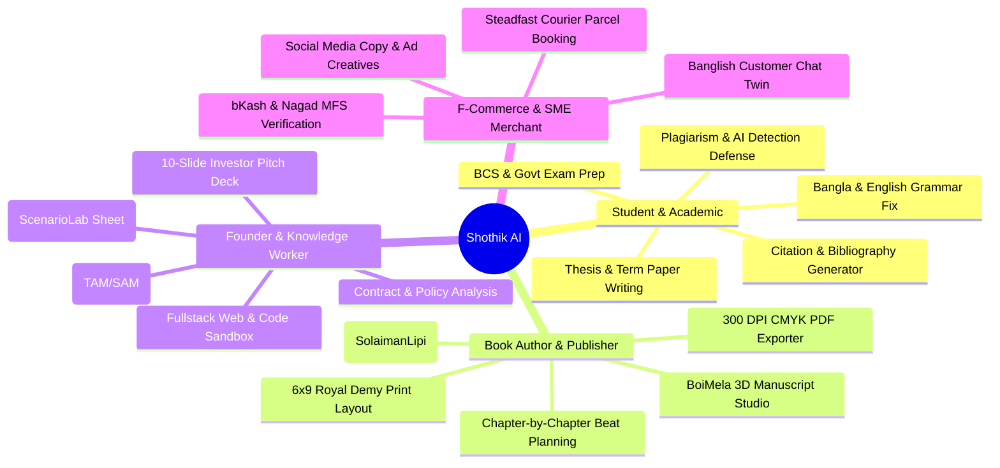
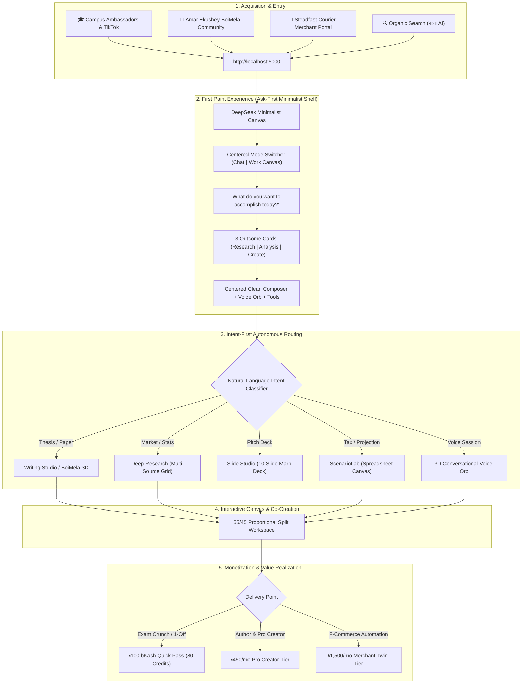

# 🗺️ Shothik AI: Master User Journey Mind Map & Workspace Architecture

---

## 1. User Types & Archetypes (Who They Are & Why They Come)



---

## 2. End-to-End User Journey (How They Arrive ➔ What They See ➔ How They Deliver)



---

## 3. Comparative Benchmarking: What We Learn From Other Agent Workspaces

| Agent Workspace | Key Strengths & Patterns | What Shothik Adopts & Adapts | What We Avoid |
| :--- | :--- | :--- | :--- |
| **DeepSeek** | • Ultra-focused Ask-First composer<br>• Quiet, collapsible `<think>` reasoning traces<br>• Zero cognitive friction on first paint | • Clean centered hero greeting + 3 intent cards<br>• Bengali thinking accordion (`ThinkBox`) with live word metric and 1-click trace copy | • Raw debug stacks on user surfaces<br>• Mode pre-selection requirements |
| **Claude Artifacts** | • 50/50 dual-pane live canvas<br>• Editable persistent outputs alongside chat | • 55/45 proportional split with non-occluding draggable handle<br>• Direct handoff into specialized studios | • Static non-interactive preview panels |
| **Perplexity AI** | • Epistemic citation badges `[1]` `[2]`<br>• Visual source domains grid<br>• Pro Search multi-step trail | • Perplexity Sources Grid & Related Queries in research tab<br>• One-click verifiable document coordinates | • Ad clutter and intrusive paywall banners |
| **v0 by Vercel** | • Live interactive UI sandboxes<br>• Instant code run & visual feedback | • Web REPL sandbox runner in Markdown code blocks<br>• CMYK 3D BoiMela live page-flip preview | • Forcing code view when user wanted human copy |
| **Genspark / Devin** | • Multi-agent planning & execution checklist<br>• Checkpoint approvals for dangerous actions | • Inline Approval Cards for irreversible actions<br>• Background Overnight Jobs with wake-up sync | • Overwhelming non-technical users with raw terminal outputs |

---

## 4. Monetization Matrix (Demography-Tailored for South Asia)

```
┌────────────────────────────────────────────────────────────────────────────────────────────────────────┐
│                                SHOTHIK TIERED MONETIZATION ENGINE                                      │
├─────────────────────────┬─────────────────────────┬──────────────────────────┬─────────────────────────┤
│    ৳100 Micro-Pass      │   ৳450/mo Student Pro   │   ৳1,200/mo Author Pro   │  ৳1,500/mo Merchant Pro │
│   (Casual & Students)   │   (Academics & Thesis)  │   (Writers & Publishers) │   (F-Commerce Stores)   │
├─────────────────────────┼─────────────────────────┼──────────────────────────┼─────────────────────────┤
│ • 80 Instant Credits    │ • 600 Monthly Credits   │ • Unlimited 3D BoiMela   │ • Unlimited Sales Twin  │
│ • bKash/Nagad 1-click   │ • AI Detector Defense   │ • 300 DPI CMYK PDF Export│ • Steadfast Courier API │
│ • 2 Deep Research runs  │ • Full Citation Engine  │ • Bengali Font Licensing │ • NBR Invoice Generator │
│ • Valid 14 Days         │ • Word/LaTeX Export     │ • ISBN & Barcode Tool    │ • Realtime bKash Reconc │
└─────────────────────────┴─────────────────────────┴──────────────────────────┴─────────────────────────┘
```

---

## 5. UI Architecture Action Plan for Immediate Polish

1. **Center `[💬 Chat | 🎴 Work Canvas]` Switcher**:
   - Move the mode switcher directly above *"What do you want to accomplish today?"* on the empty state canvas.
2. **Prominent 3D Voice Orb Launcher**:
   - Mount an explicit interactive Voice Orb button directly in the composer bottom toolbar and header.
3. **Backend-Free Human Persona Taxonomy**:
   - `Shothik Core` (General AI) ➔ `Deep Analyst` (Research & Papers) ➔ `Creative & Business Partner` (Manuscripts & Slides).
4. **Focused Tools Menu**:
   - Clean, outcome-oriented tools (*Deep Research*, *Slide Studio*, *Financial Model*, *Code Engine*, *3D BoiMela Studio*).
