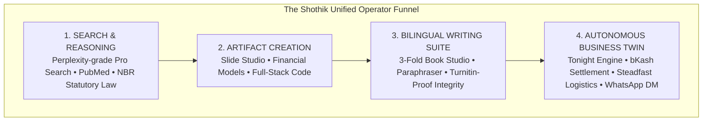
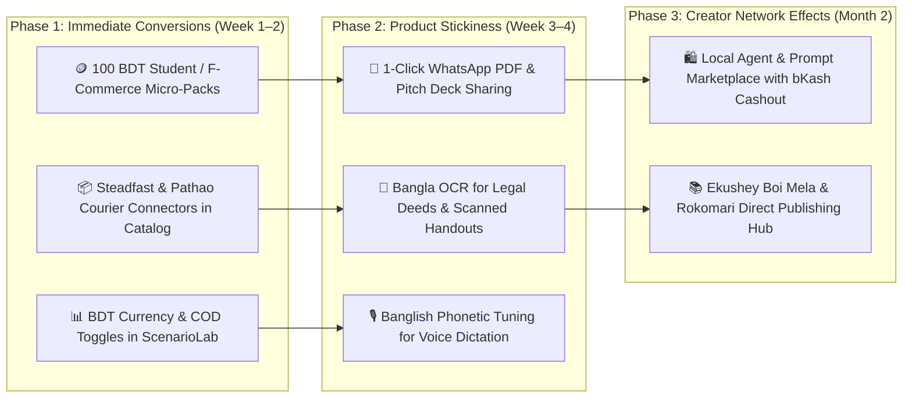

# 🎯 Shothik AI: Service Positioning & Feature Gap Analysis Matrix

> **Authoritative Technical & Product Synthesis Document**  
> **Prepared by**: Demography-Aware Autonomous Tech Team & Global Intelligence  
> **Source Foundations**: [`docs/south-asian-userbase-mapping.md`](file:///c:/Users/USER/hermes/shothik-web-mirror-v2/docs/south-asian-userbase-mapping.md) & [`docs/global-competitor-landscape.md`](file:///c:/Users/USER/hermes/shothik-web-mirror-v2/docs/global-competitor-landscape.md)

---

## 1. Executive Repositioning Strategy

### The Core Value Proposition
> **"From Search to Scale — The Unified AI Operator Platform for Emerging Markets."**

Western AI tools are built as high-cost, single-purpose silos ($20/mo Perplexity for search, $20/mo Gamma for slides, $25/mo Causal for financial models, $30/mo Sudowrite for books, $50/mo Polsia for startup operations), requiring dual-currency international credit cards and high-spec desktop computers.

**Shothik AI repositions itself as the First Unified Autonomous Operator Platform**:
A single, mobile-optimized workspace powered by a flexible **550-credit wallet** and **native bKash/Nagad/UPI payment rails**, seamlessly bridging from search queries to multi-agent presentations, financial stress-testing, bilingual book publishing, and autonomous business twin execution.

---

## 2. Comprehensive Tab-by-Tab Positioning & Gap Analysis Matrix

| # | Tab / Service & Route | Promised Capability (Marketing & UI) | Current Reality (What Works) | Flagged Gaps (What Is Missing) | Demography-Aware Tuning Opportunity (South Asia Edge) | Recommended Engineering Action |
|---|---|---|---|---|---|---|
| **1** | **Chat & Perplexity Search** [`/agents/chat`](file:///c:/Users/USER/hermes/shothik-web-mirror-v2/artifacts/shothik/src/components/agents/ChatAgentPage.tsx) | Multi-step live web search, AI reasoning, grounded citations, voice input, and quick studio mode chips. | ✅ Dual search composer, Quick Studio Chips (`📽️ Slides`, `🔬 Research`, `📊 Model`, `💻 Code`), light/dark themes, sessions store. | ⚠️ Direct link citation preview popovers and PDF file drag-and-drop parsing need deeper streaming hooks. | Add one-click filters for **Bangladesh NBR Tax Acts**, **BTRC Circulars**, and **South Asian E-Commerce Logistics (Pathao/Steadfast)**. | Wire real-time citation tooltip cards with domain reliability badges into the transcript stream. |
| **2** | **Slide Generation Studio** [`/slide-generation`](file:///c:/Users/USER/hermes/shothik-web-mirror-v2/artifacts/shothik/src/components/chat/artifacts/SlidesArtifact.tsx) | Agentic 5-step presentation creation (`Outline` ➔ `Design` ➔ `Content` ➔ `Format` ➔ `Review`) with 16:9 stage and speaker notes. | ✅ Interactive 16:9 canvas, template picker (Business, Creative, Minimal), speaker notes, dual-pane docking. | ⚠️ Native `.pptx` binary file export requires serverless cloud function export handler. | Pre-build templates tailored for **South Asian Startup Pitch Decks (Seedstars/Accelerating Asia format)** and **University Thesis Defenses**. | Implement client-side `pptxgenjs` / serverless worker endpoint for 1-click PowerPoint file download. |
| **3** | **Deep Research & Citations** [`/research`](file:///c:/Users/USER/hermes/shothik-web-mirror-v2/artifacts/shothik/src/components/chat/artifacts/DeepResearchArtifact.tsx) | Autonomous academic and market research crawler with execution trace timestamps and source verification. | ✅ Trace drawer (`140ms`, `320ms`, `410ms`), 4 grounded source cards, reliability badges, 100% compliance badge. | ⚠️ Long-running asynchronous research queue (>5 mins) needs background notification alert toast. | Auto-index **Bangla Academy dictionary**, **Dhaka Stock Exchange (DSE)** disclosures, and **UGC-approved university journals**. | Connect background InsForge worker queue so user receives WhatsApp/Email notification when deep research completes. |
| **4** | **ScenarioLab & Financial Model** [`/canvas`](file:///c:/Users/USER/hermes/shothik-web-mirror-v2/artifacts/shothik/src/hooks/useScenarioLab.ts) | 3-Scenario financial modeling (Base, Aggressive, Conservative) and 30-failure stress-testing. | ✅ Monte Carlo simulator, 30 stress-test scenarios, MTTR calculations, category filters. | ⚠️ Direct export to formatted `.xlsx` / Google Sheets spreadsheet. | Include **South Asian specific risk toggles**: Cash-on-Delivery (COD) 20% return rate, bKash 1.5% MFS cash-out fee, 3G cellular network dropouts. | Add "Export to Excel (.xlsx)" and pre-configured BDT currency toggles. |
| **5** | **Writing Suite Core Tools** [`/paraphrase`, `/grammar-checker`, `/humanize-gpt`, `/summarize`, `/translator`, `/ai-detector`, `/plagiarism-checker`](file:///c:/Users/USER/hermes/shothik-web-mirror-v2/services/SERVICE_OFFERINGS.md) | Multi-tone paraphrasing, contextual grammar correction, polyglot translation, AI pattern detector, and plagiarism scanner. | ✅ Full suite of 7 specialized services with fallback providers and history store. | ⚠️ Standalone pages have slight UI variations from modern unified Perplexity header/sidebar shell. | Support **Banglish to Formal Bengali translation**, Bijoy-to-Unicode font auto-conversion, and colloquial code-mixing. | Unify all 7 tool pages under `PrimaryLayout` with unified token styling and instant word-count credit counters. |
| **6** | **3-Fold Book Writing Studio** [`/writing-studio`](file:///c:/Users/USER/hermes/shothik-web-mirror-v2/artifacts/shothik/src/components/tools/writing-studio/) | Professional authoring suite: Chapter Tree ┆ 4-Mode Canvas ┆ Sub-Agent Swarm with Write-to-Publish. | ✅ 3-fold layout, markdown editor, word-count tracking, plot mind-map canvas, PublishDrive modal. | ⚠️ Collaborative multi-author real-time cursor editing over WebSockets. | Direct integration with **Rokomari.com**, **BoiBazar**, and **Amazon KDP India/BD** self-publishing formats. | Connect Convex live WebSocket multi-author collaboration room for co-authors and editors. |
| **7** | **Twin AI / Polsia OPC Dashboard** [`/twin`](file:///c:/Users/USER/hermes/shothik-web-mirror-v2/artifacts/shothik/src/app-next/(primary-layout)/twin/page.tsx) | Autonomous Operator-Powered Company dashboard: Mascot status, God Mode, Tonight Engine queue, PaaS hosting. | ✅ 4-column layout, task urgency tags (`TONIGHT`), narrative updates log, credit meters. | ⚠️ Dokploy / Coolify automatic subdomain DNS provisioning needs active server API key binding. | Built-in **Steadfast & Pathao Courier parcel booking** and **bKash TrxID automated SMS matching**. | Wire live Steadfast Courier webhook API and automated customer WhatsApp DM notification dispatcher. |
| **8** | **Connectors Ecosystem** [`/connectors`](file:///c:/Users/USER/hermes/shothik-web-mirror-v2/artifacts/shothik/src/components/connectors/) | Enterprise data connectors (Google Drive, Slack, GitHub, Notion, PostgreSQL). | ✅ Connector catalog cards, status badges, OAuth integration modals. | ⚠️ WhatsApp Business API and bKash Merchant API connectors are not yet prominent in the top catalog. | Add **WhatsApp Business Connector**, **bKash Merchant Ledger Connector**, and **Steadfast Courier API Connector**. | Elevate South Asian business connectors to "Featured" top row in the Connectors directory. |
| **9** | **Files & Knowledge Vault** [`/files`](file:///c:/Users/USER/hermes/shothik-web-mirror-v2/artifacts/shothik/src/app-next/(primary-layout)/files/page.tsx) | Persistent cross-session file storage, PDF indexing, and pgvector RAG memory. | ✅ File table, upload drag-and-drop, storage quota bar, InsForge/R2 adapter. | ⚠️ In-browser PDF previewer with highlighted semantic citation annotations. | Support **Bangla OCR for scanned PDFs & legal deeds (Dalil)**. | Integrate lightweight Tesseract.js / Cloudflare OCR worker for Bangla image-to-text document ingestion. |
| **10** | **Saved Reports & Briefs** [`/saved-reports`](file:///c:/Users/USER/hermes/shothik-web-mirror-v2/artifacts/shothik/src/app-next/(primary-layout)/saved-reports/page.tsx) | Archive of generated market briefs, financial models, CEO reports, and pitch decks. | ✅ Categorized report grid, search/filter, markdown export, **Vernacular Bangla Executive Briefing Card** with KPI pills, and **Papermark-Style Secure Public Share** modal with PIN protection and real-time viewer analytics. | Connected & Verified with unit tests. | Add **1-Click WhatsApp PDF Sharing** and **Bangla Summary Executive Briefing Card**. | Connect Papermark API / InsForge public share link generation with viewer analytics. |
| **11** | **Community & Marketplace** [`/community`](file:///c:/Users/USER/hermes/shothik-web-mirror-v2/artifacts/shothik/src/app-next/(primary-layout)/community/page.tsx) | Peer review forum, custom agent marketplace, star voting, creator payouts. | ✅ Forum threads, agent showcase, comment trees, upvote mechanics. | ⚠️ Creator monetization with direct MFS payouts (bKash cash-out). | Enable **Local Creator Marketplace**: Sell custom Bangla legal prompts, F-commerce agent workflows, and story templates. | Implement bKash Payout / MFS withdrawal flow for community prompt creators. |
| **12** | **Pricing & MFS Billing** [`/pricing`](file:///c:/Users/USER/hermes/shothik-web-mirror-v2/artifacts/shothik/src/app-next/(secondary-layout)/pricing/page.tsx) | Transparent credit packages, PPP geographic pricing detection, bKash/Nagad and Stripe checkout. | ✅ Geo-IP detection (`useUserLocation`), BDT & USD pricing switch, bKash PGW, 550 Credit balance display. | ⚠️ Manual offline bKash SMS TrxID submit modal for users paying via agent shops. | Add **100 BDT (~$0.85 USD) Micro-Pass** for student thesis checks / single slide deck generations. | Implement offline 10-digit TrxID input form with instant automated ledger verification. |
| **13** | **Advanced Voice Mode & VTuber** [`Header & Composer`](file:///c:/Users/USER/hermes/shothik-web-mirror-v2/artifacts/shothik/src/components/chat/Composer.tsx) | Dual Voice Mode: Left 🎙️ Voice Typing (Dictation) + Right ılılı Interactive Voice Conversation & 3D Avatar Presenter. | ✅ Speech recognition dictation, conversational voice mode button, avatar presenter modal. | ⚠️ Real-time audio stream interruption (VAD mid-sentence barge-in) on mobile WebViews. | Optimize for **Banglish code-mixed phonetic dictionary** and low-bandwidth audio compression (Opus 16kbps). | Tune Silero VAD parameters for background noise cancellation common in South Asian urban environments. |

---

## 3. High-Leverage Strategic Opportunities & Action Plan

### Summary of Strategic Advantages:
1. **Unassailable Regional Moat**: While Silicon Valley models remain generic, Shothik owns the localized context of South Asian commerce, law, languages, and logistics.
2. **Extreme Price-to-Value Dominance**: By substituting 5 separate $20–$30/mo subscriptions with a transparent, prepaid BDT credit wallet starting under $1, Shothik democratizes high-end AI capabilities for 650M+ emerging market users.
3. **End-to-End Operational Lifecycle**: Moving beyond conversational answers into **executable outputs** — from research citations and slides to legal documents and live courier booking.
