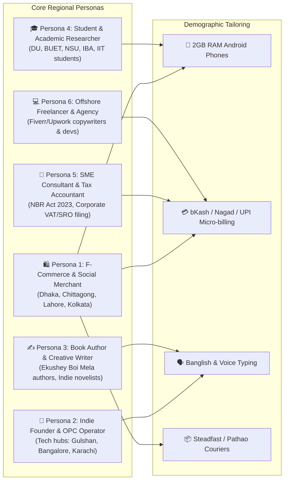
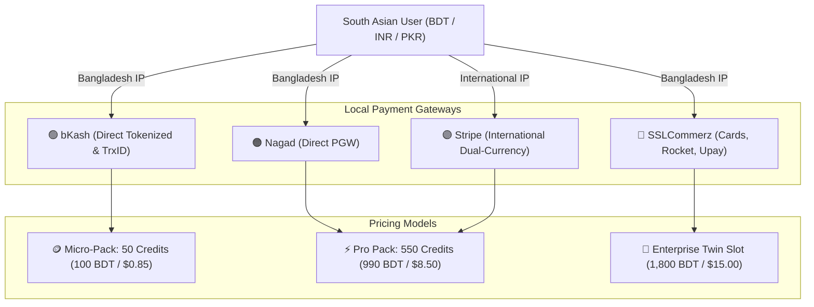

# 🇧🇩 South Asian Demographic & Regional Market Userbase Mapping

> **Authoritative Technical & Product Mapping Report**  
> **Prepared by**: Demography-Aware Autonomous Tech Team & Research Intelligence  
> **Target Geographies**: Bangladesh (Primary), India, Pakistan, Sri Lanka, Nepal (South Asian Emerging Markets)  
> **Target User Population**: 1.9 Billion People (~650M+ Internet & Smartphone Users)

---

## 1. Executive Summary & Market Demographics

South Asia represents one of the fastest-growing digital economies globally, characterized by rapid mobile internet penetration, mobile financial services (MFS) dominance, and booming micro-entrepreneurship (F-commerce, SME manufacturing, freelance digital services, and independent publishing). 

However, global AI platforms (such as OpenAI ChatGPT, Perplexity AI, Anthropic Claude, and Sudowrite) are fundamentally engineered for Western desktop environments, high-spec iPhones/MacBooks, high-bandwidth fiber connections, and USD credit-card subscription billing.

**Shothik AI's demographic advantage** lies in building hyper-localized, demography-aware AI infrastructure optimized for:
1. **Low-spec 2GB–4GB RAM Android devices** operating over 3G/4G cellular networks.
2. **Local MFS Payment Rail integration** (bKash, Nagad, Rocket, Upay, SSLCommerz, and UPI).
3. **Banglish and Code-Mixed NLP pipelines** supporting phonetic, colloquial, and regional dialects.
4. **Hyper-Local Business Workflows** (F-commerce order confirmation, NBR tax rebates, Steadfast/Pathao courier tracking, and regional book publishing).

---

## 2. South Asian User Personas & Archetypes

### Persona 1: The F-Commerce & Social Media Merchant
* **Demographic Profile**: Age 20–38; operates boutique fashion, gadget, or organic grocery businesses on Facebook, Instagram, and WhatsApp.
* **Geographic Spread**: Dhaka, Chittagong, Sylhet, Lahore, Karachi, Surat, Jaipur.
* **Core Pain Points**:
  - Manual customer messaging and parcel booking takes 4–6 hours daily.
  - Return to Origin (RTO) / parcel refusal rates average 18%–25% with Cash-on-Delivery (COD).
  - Lack of formal business accounting and inventory tracking.
* **Shothik Service Fit**:
  - **Social Commerce Copilot**: Auto-generates product copy in Banglish, drafts WhatsApp customer replies.
  - **Logistics Courier Dispatcher**: One-click booking with Steadfast, Pathao, and RedX with automated WhatsApp tracking DMs.
  - **COD Fraud Verification**: Flags fake phone numbers and high return risk customers before dispatch.

### Persona 2: The Indie Tech Founder & OPC Operator
* **Demographic Profile**: Age 22–35; software engineers, product managers, or agency owners building micro-SaaS, B2B tools, or local marketplace solutions.
* **Geographic Spread**: Dhaka (Banani/Dhanmondi), Bangalore, Hyderabad, Islamabad.
* **Core Pain Points**:
  - High cost of Western developer tools ($20/mo Perplexity + $20/mo ChatGPT + $50/mo Vercel/Cursor).
  - Lack of access to international dual-currency credit cards (BTRC / Bangladesh Bank quota limits).
  - Difficulty calculating regional TAM/SAM/SOM and local compliance requirements.
* **Shothik Service Fit**:
  - **Cofounder & ScenarioLab**: Calculates localized TAM/SAM/SOM, simulates 3G packet dropouts and bKash TrxID fraud.
  - **Code Engine & Dokploy Deployer**: Generates full-stack React/Node/PostgreSQL schemas and deploys standalone containers to local VPS nodes.
  - **Local MFS Billing**: 550 Credit bundles purchasable via bKash/Nagad in BDT.

### Persona 3: The Book Author & Creative Publisher
* **Demographic Profile**: Age 24–65; fiction writers, poets, Islamic literature authors, academic textbook writers preparing for Ekushey Boi Mela or Amazon KDP.
* **Geographic Spread**: Pan-Bangladesh (Dhaka, Rajshahi, Khulna), West Bengal (Kolkata).
* **Core Pain Points**:
  - Inefficient manual typesetting, font encoding issues with Bijoy / Unicode Bengali.
  - High cost of traditional publishing and lack of digital distribution channels.
  - Plagiarism and unauthorized copying in local publishing markets.
* **Shothik Service Fit**:
  - **3-Fold Book Writing Studio**: Chapter outline planning, character relationship graphs, and word-count pacing.
  - **Write-To-Publish**: Direct EPUB/PDF generation with PublishDrive and Rokomari distribution hooks.
  - **Dual Bengali / English Plagiarism & Citation Detection**: Scans academic literature and web archives.

### Persona 4: University Students & Academic Researchers
* **Demographic Profile**: Age 18–26; studying at public/private universities (DU, BUET, NSU, BRAC, IBA, IIT, NUST).
* **Geographic Spread**: All major university clusters in South Asia.
* **Core Pain Points**:
  - Strict plagiarism rules (Turnitin thresholds) for dissertations and semester term papers.
  - English language barrier when translating complex academic concepts into clear thesis prose.
  - Lack of international payment options for accessing academic journals.
* **Shothik Service Fit**:
  - **Academic Deep Research**: Free access to open academic search (PubMed, bioRxiv, Europe PMC, OpenAlex).
  - **Paraphraser & Humanizer**: Rewrites complex sentences into fluent academic tone without distorting domain terms.
  - **Grammar & Spell Checker**: Contextual spelling and grammar checking for both English and formal Bengali.

### Persona 5: SME Tax Consultants & Corporate Accountants
* **Demographic Profile**: Age 28–55; chartered accountants, VAT practitioners, and small business owners managing fiscal compliance.
* **Geographic Spread**: Commercial districts in South Asian metropolises.
* **Core Pain Points**:
  - Frequent updates to National Board of Revenue (NBR) Income Tax Act 2023, SRO notifications, and VAT rates.
  - Manual calculation of Section 78 investment tax rebates and corporate depreciation tables.
* **Shothik Service Fit**:
  - **Pro Search (Statutory Law Filter)**: Grounded legal search cross-referencing official NBR gazettes, SROs, and Bangladesh Bank circulars.
  - **ScenarioLab Financial Model**: Automated 3-scenario forecasting with regional tax deductions.

---

## 3. Regional Hardware, Network & Infrastructure Constraints

| Infrastructure Metric | Western Market Baseline | South Asian Reality | Shothik Engineering Optimization |
| :--- | :--- | :--- | :--- |
| **Smartphone RAM** | 8GB–12GB (iPhone 15 / Galaxy S24) | **2GB–4GB RAM (Redmi 9A, Walton, Symphony)** | Lightweight DOM, virtualized lists, zero memory-leak closures |
| **Network Latency & Bandwidth** | 5G / Fiber (>100 Mbps, <15ms) | **3G / 4G (1.5–8 Mbps, 90–250ms latency)** | Compressed chunked payloads, asset caching via Cloudflare CDN |
| **Primary Input Method** | Full physical/virtual keyboard | **Voice Dictation & Banglish Romanized typing** | Integrated Whisper speech-to-text with code-mixed dictionary |
| **Primary Communication Hub** | Email, Slack, Microsoft Teams | **WhatsApp, Messenger, IMO, Telegram** | WhatsApp Broadcast dispatcher, mobile deep links |
| **Browser Environment** | Chrome Desktop, Safari Mobile | **Chrome Mobile, UC Browser, Opera Mini, In-App WebViews** | Strict CSS fallback compatibility, zero desktop-only CSS traps |

---

## 4. Financial Rails & Micro-Billing Ecosystem

### Local Payment Invariants:
1. **No Subscription Lock-in**: South Asian consumers strongly reject recurring auto-debit on credit cards. **Prepaid credit wallets (e.g. 550 Credits)** match regional spending behavior.
2. **Instant TrxID Verification**: Support for both direct PGW popups and offline 10-digit SMS `TrxID` reconciliation for users transacting via agent points.
3. **Purchasing Power Parity (PPP) Pricing**: A $20/month subscription represents ~15% of a fresh graduate's monthly salary in Dhaka or Karachi. Shothik's pricing starts at **99 BDT (~$0.85 USD)** for entry-level task packs.

---

## 5. Strategic Summary of Regional Advantages

1. **Defensible Local Moat**: Global AI giants will not integrate bKash TrxID webhooks, Steadfast courier APIs, or NBR SRO legal corpora due to niche regional focus.
2. **Voice-First Accessibility**: By integrating dual voice modes (Dictation + Interactive Voice Mode), Shothik opens advanced AI capabilities to non-fluent English speakers and mobile-only users.
3. **All-in-One Convergence**: Combining Search, Presentations, Financial Modeling, Writing Tools, and Autonomous Business Agents inside a single workspace eliminates the need for 5 separate expensive subscriptions.
