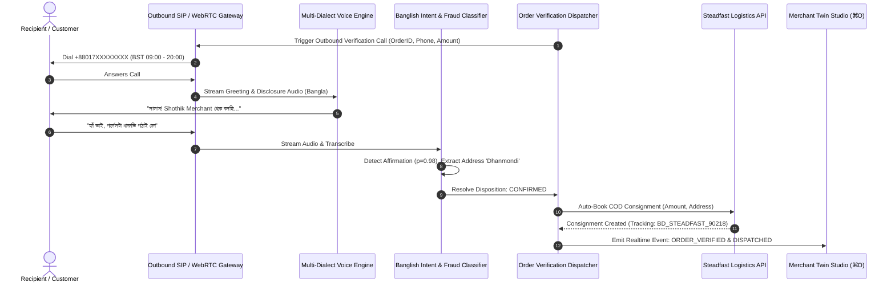

# 0029. Autonomous AI Outbound Calling & COD Order Verification

**Date**: 2026-09-18  
**Status**: Proposed

## Summary

This specification defines the architecture, conversational IVR state machine, and fraud prevention engine for **Autonomous AI Outbound Calling & COD Order Verification**. It enables solo-entrepreneurs and OPC merchants in Bangladesh to automatically call customers who place Cash on Delivery (COD) orders via WhatsApp, Facebook, or web storefronts. The voice agent converses in natural Bengali dialects to verify purchasing intent, confirm precise shipping addresses, identify bogus or duplicate orders, and automatically transition verified orders to Steadfast/Pathao courier booking without human intervention.

---

## Context

In South Asian e-commerce—and Bangladesh specifically—Cash on Delivery (COD) accounts for 75% to 85% of retail transactions. However, merchants face a 15%–30% **Return to Origin (RTO)** rate caused by fake orders, impulsive purchases, duplicate submissions, and incorrect delivery addresses. Every returned parcel incurs a double delivery fee (pickup + return penalty) of ৳120–৳200 from couriers like Steadfast and Pathao, severely eroding micro-merchant margins.

Manual phone verification by the merchant takes 3–5 minutes per order, creates fulfillment bottlenecks, and is impossible to scale during seasonal sales (Eid, Boi Mela, Puja). A conversational AI voice agent that dials immediately upon order placement, handles natural vernacular dialogue, and makes deterministic dispatch/cancel decisions eliminates fraud and protects merchant cash flow.

---

## Requirements

### User Stories
- **As a merchant**, I want the system to automatically call customers within 5 minutes of placing a COD order so that fake or accidental orders are cancelled before dispatch fees are incurred.
- **As a merchant**, I want verified orders to be automatically booked into Steadfast/Pathao logistics with exact delivery address coordinates.
- **As a customer**, I want a polite, clear call in my preferred dialect (Dhakaiya, Sylheti, Chatgaya, or Standard Bangla) confirming my order total, delivery fee, and address with simple voice confirmation.
- **As a business owner**, I want complete compliance with BTRC (Bangladesh Telecommunication Regulatory Commission) calling guidelines (operating hours 9 AM–8 PM, recording disclosure, opt-out).

### Acceptance Criteria
- **AC-1 (Telephony Ingress & Call Dispatch)**: The engine dispatches automated SIP/WebRTC outbound calls to valid 11-digit Bangladeshi mobile numbers (`+8801[3-9]\d{8}`) with configurable caller IDs.
- **AC-2 (BTRC Compliance & Operating Window Gate)**: Calls are strictly scheduled between 09:00 and 20:00 BST. Orders placed after hours are queued for 09:15 BST next morning. Calls include statutory audio disclaimer (*"কলটি সেবার মান ও অর্ডার নিশ্চিতকরণের জন্য রেকর্ড করা হচ্ছে"*).
- **AC-3 (Dialect-Adaptive Dialog State Machine)**: Evaluates customer speech across 4 states:
  1. `GREETING_AND_DISCLOSURE`: Introduce store and state call purpose.
  2. `ORDER_AND_AMOUNT_CONFIRM`: Announce item count, product name, and total COD amount (in BDT).
  3. `ADDRESS_VERIFICATION`: Confirm delivery district, thana, and road details.
  4. `DISPOSITION_SETTLEMENT`: Handle confirmation, modification request, cancellation, or reschedule.
- **AC-4 (Deterministic Intent & Sentiment Extraction)**:
  - **CONFIRMED**: Affirmative tokens (*"হ্যাঁ পাঠান"*, *"ঠিক আছে"*, *"confirm korlam"*, *"ji bhai pathan"*) -> Status `verified_for_dispatch`.
  - **CANCELLED**: Cancellation tokens (*"দরকার নাই"*, *"ভুল হইসে"*, *"cancel koren"*, *"order cancel"*) -> Status `cancelled_customer_request`.
  - **ADDRESS_CHANGE**: Address update tokens (*"thikana change"*, *"Banani na Dhanmondi te"*) -> Status `requires_address_update`.
  - **RESCHEDULE / BUSY**: Request to call later (*"pore phone den"*, *"bysto achi"*) -> Status `retry_scheduled` (exponential backoff: 30m, 2h, next day; max 3 attempts).
- **AC-5 (Supervised Autonomy Gate)**: Orders with high discrepancy, voice stress/hostility, or value $\ge$ ৳10,000 are escalated to Merchant Twin Studio for manual intervention.
- **AC-6 (Steadfast Logistics Auto-Booking Seam)**: Orders transitioning to `verified_for_dispatch` automatically call the Steadfast Courier API to book parcel pickup and receive a tracking code (`BD_STEADFAST_XXXXXX`).
- **AC-7 (Twin Studio Interactive Outbound Console)**: Frontend provides a live verification console with call audio playback, waveform VAD telemetry, transcripts, and 1-click manual override (`⌘O` / `Ctrl+O`).

---

## Options Considered

### Option 1: Native WebRTC / SIP Telephony Adapter with Local Kokoro/Bangla-VITS & Fast VAD (Recommended)
Integrate standard SIP trunking (e.g. Twilio Voice, Telnyx, or local Bangladesh PSTN SIP gateway) paired with Shothik's sub-50ms model mesh, Kokoro audio synthesis, and Silero/RMS VAD barge-in.

- **Pros**: Low latency (<400ms turn-around), zero per-seat SaaS costs, full control over regional dialect models and call recording ledgers.
- **Cons**: Requires managing SIP connection state and WebRTC audio streams.

### Option 2: Third-Party Closed IVR SaaS (e.g. Bland.ai / Retell AI)
Delegate calls to an offshore voice AI SaaS API.

- **Pros**: Quick turn-key setup for generic English.
- **Cons**: Poor Banglish and regional dialect (Dhakaiya, Sylheti, Chatgaya) speech recognition; expensive per-minute USD billing; latency >1500ms routing through foreign servers.

---

## Decision

**Chosen Option**: **Option 1 (Native WebRTC/SIP Telephony Adapter with Multi-Dialect Voice Twin & Banglish Intent Classifier)**.

---

## Architecture & Data Flow

---

## Data Schema & Value Sourcing

| Field | Source | Extraction Method | Fallback |
|---|---|---|---|
| `callId` | Telephony Ingress | `call_out_` + Timestamp + Hex | Generated UUID |
| `orderId` | Merchant Commerce DB | Ingested from WhatsApp/Storefront | Required |
| `customerPhone` | Ingested Order | E.164 Bangladeshi Format Validation | Reject if invalid |
| `customerName` | Ingested Order | Unicode string | `"সম্মানিত গ্রাহক"` |
| `grandTotalBdt` | Mushak-6.3 Engine | Statutory Total (Subtotal + VAT + Delivery) | Order raw price |
| `dialect` | Session / Geolocation | Auto-detected from customer city/district | `standard` |
| `callStatus` | Telephony State | `queued` \| `ringing` \| `in_progress` \| `completed` \| `failed` | `queued` |
| `verificationDisposition` | Intent Classifier | `CONFIRMED` \| `CANCELLED` \| `ADDRESS_MODIFIED` \| `RETRY_SCHEDULED` \| `ESCALATED` | `RETRY_SCHEDULED` |
| `trackingCode` | Steadfast API | Generated on automated consignment booking | `null` until verified |

---

## Test & Verification Plan

1. **Unit Tests (`outbound-call-engine.test.ts`)**:
   - Verify phone number E.164 sanitization (`+88017...`, `018...`).
   - Test BTRC operating hours gate (9:00 - 20:00 BST pass; 22:00 BST deferred to 9:15 next morning).
   - Test Banglish intent classification: Positive confirmation, cancellation, address modifications, and reschedule requests.
   - Test retry scheduler with exponential backoff (Attempt 1 -> 30m, Attempt 2 -> 2h, Attempt 3 -> Terminate/Cancel).
   - Test Supervised Autonomy gate for orders $\ge$ ৳10,000 or negative customer sentiment.

2. **Integration Tests (`api-server/src/routes/__tests__/outbound-verification.test.ts`)**:
   - `POST /api/v1/telephony/outbound/initiate`: Triggers call session.
   - `POST /api/v1/telephony/outbound/webhook`: Handles telephony carrier status callbacks.
   - `POST /api/v1/telephony/outbound/transcribe-turn`: Evaluates audio turn and returns synthesized voice response.
   - `GET /api/v1/telephony/outbound/sessions`: Lists live call journal with waveform metrics.
   - `POST /api/v1/telephony/outbound/override`: Merchant 1-click manual verification/cancel override.

3. **Frontend Component Tests (`OutboundCallVerificationModal.test.tsx`)**:
   - Renders call overview, audio visualizer, BTRC compliance badge, and recent call queue.
   - Handles dialect switching and manual dispatch triggers.
   - Shortcut verification: `⌘O` / `Ctrl+O`.
