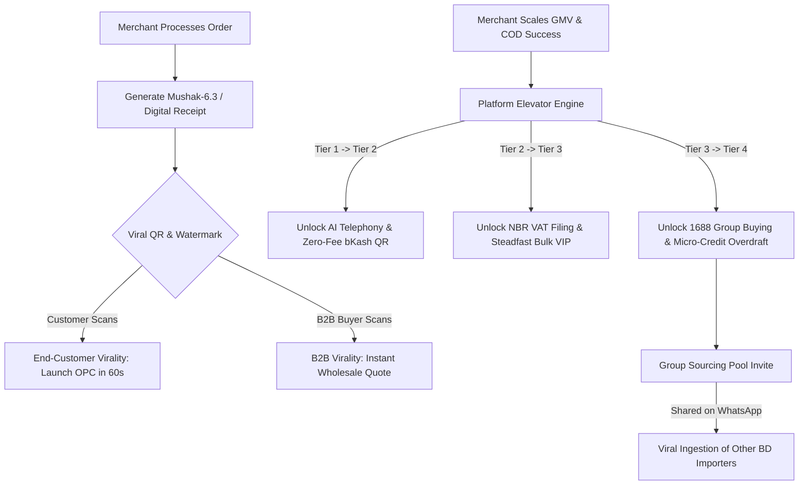

# 🚀 Spec 0031: Platform Elevators & Viral Growth Triggers

**Status**: Approved & Active  
**Monorepo Package**: `@workspace/api-server`, `@workspace/shothik`  
**Governing Pattern**: Product-Led Growth (PLG), Viral K-Factor Loops, Gamified OPC Level Progression, and South Asian Merchant Network Dynamics  

---

## 1. Executive Summary & Problem Context

In the Bangladeshi e-commerce landscape (F-Commerce, WhatsApp Commerce, physical retail), customer acquisition cost (CAC) through Meta/Google ads is unsustainable for solo entrepreneurs. Furthermore, solo merchants operate without institutional credit or volume discounts.

To transform individual merchants into self-scaling One-Person Companies (OPCs) with a high viral growth coefficient ($K > 1.2$), ShothikGPT implements two symbiotic growth mechanics:
1. **Platform Elevators**: Automated tier progression that unlocks tangible operational powers (higher AI telephony quotas, lower Steadfast courier rates, instant bKash working capital limits, and automated NBR tax filing) as merchant GMV and fulfillment metrics scale.
2. **Viral Growth Triggers**: Organic product-embedded distribution loops that turn daily business operations (invoices, WhatsApp quotes, group sourcing pools, delivery trust seals) into viral customer & merchant acquisition flywheels.



---

## 2. Platform Elevators: The OPC Scaling Progression

Merchants advance through 4 operational tiers calculated continuously from a composite **Merchant Health Index (MHI)**.

### 2.1 Merchant Health Index (MHI) Formula
$$\text{MHI} = (0.40 \times \text{GMV Score}) + (0.35 \times \text{COD Delivery Rate}) + (0.15 \times \text{Fulfillment Speed}) + (0.10 \times \text{Verification Score})$$

Where:
- $\text{GMV Score} = \min(100, \frac{\text{Monthly GMV (BDT)}}{15,000})$
- $\text{COD Delivery Rate} = \frac{\text{Successfully Delivered Orders}}{\text{Total Dispatched Orders}} \times 100$
- $\text{Fulfillment Speed} = \max(0, 100 - (\text{Avg Hours from Order to Dispatch} \times 2))$
- $\text{Verification Score} = \text{NBR BIN Verified (50 pts)} + \text{NID OCR Passed (50 pts)}$

---

### 2.2 Elevator Tiers & Automated Privileges

| Tier Level | Designation | Monthly GMV Threshold | Minimum MHI | Unlocked Platform Privileges & Elevators |
|:---|:---|:---|:---:|:---|
| **Level 1** | **Rookie Solopreneur** | ৳0 – ৳50,000 | 0 | • Basic Chat Assistant<br>• Manual Steadfast / Pathao Booking<br>• 10 AI Outbound Phone Verifications / month |
| **Level 2** | **Rising OPC** | ৳50,001 – ৳300,000 | 65 | • **Autonomous Outbound IVR Calling (100 calls/mo)**<br>• **Zero-Fee Dynamic bKash/Nagad QR Generator**<br>• Automated Steadfast Pickup Scheduling |
| **Level 3** | **Power Merchant** | ৳300,001 – ৳1,500,000 | 80 | • **Automated NBR Mushak-6.3 & Mushak-9.1 VAT Return**<br>• Multi-Store Real-Time Stock Matrix Sync<br>• **৳5/parcel Steadfast Delivery Discount Rebate**<br>• 500 AI Outbound Verification calls / month |
| **Level 4** | **Enterprise Franchise** | > ৳1,500,000 | 90 | • **Instant ৳100k–৳500k Working Capital Micro-Credit**<br>• **1688 Cross-Border Group Sourcing Pool Master**<br>• Dedicated Sub-50ms Speculative Inference Node<br>• Unlimited AI Telephony & Multi-Branch Delegation |

---

## 3. Viral Growth Loops & K-Factor Triggers

### 3.1 Loop 1: Viral Watermarked Mushak-6.3 & Digital Receipt
- Every digital invoice generated via WhatsApp or PDF contains a tamper-proof verification footer:
  - *Footer Text*: `"Verified Mushak 6.3 • Generated with ShothikGPT Agentic OS"`
  - *Dynamic QR*: Links to `https://shothik.app/verify/{invoice_id}?ref={merchant_code}`.
  - *Conversion*: Scanning allows the buyer to view tracking and presents a 1-tap button: *"Start your own automated business for free"*.

### 3.2 Loop 2: WhatsApp Interactive Quotation Micro-Apps
- Merchants generating wholesale B2B quotes generate an interactive 1-click WhatsApp card.
- Recipient can adjust quantities, select delivery district, and tap *"Confirm via bKash/COD"*.
- Referral attribution tag is permanently appended to the quotation metadata.

### 3.3 Loop 3: bKash/Nagad Referral Credit Ledger
- When an existing merchant refers a new merchant:
  - New merchant receives **50 Free AI Phone Verification Minutes**.
  - Referring merchant receives **৳50 bKash Wallet Cashback** automatically upon the referee's first 5 successfully delivered COD orders.

### 3.4 Loop 4: Verifiable COD Trust Badge & Delivery Seal
- Merchants embed a lightweight HTML/SVG widget on their Facebook / Web shop:
  - Displays live certified metrics: `🛡️ Verified Shothik Merchant • 98.4% COD Delivery Success (Steadfast Certified)`.
  - Clicking the badge opens the public verification certificate and an affiliate signup trigger.

### 3.5 Loop 5: 1688 Cross-Border Group Sourcing Cohorts
- Importers sourcing from China can initialize a **Group Sourcing Pool** (e.g. 1,000 units of TWS Earbuds to hit Sea LCL tariff tier).
- Generates a shareable WhatsApp invite link: `"Join our Chittagong Sea LCL container pool for HS 8518.30.00 — Save 45% on freight"`.
- Participating merchants join via ShothikGPT, instantly virally onboarding new import merchants.

---

## 4. Architectural Implementation & Data Contracts

### 4.1 Data Schema (`lib/growth/types.ts`)

```typescript
export type GrowthTierLevel = 1 | 2 | 3 | 4;

export interface MerchantElevatorProfile {
  merchantId: string;
  merchantName: string;
  currentTier: GrowthTierLevel;
  tierTitle: "Rookie Solopreneur" | "Rising OPC" | "Power Merchant" | "Enterprise Franchise";
  mhiScore: number;
  monthlyGmvBdt: number;
  codDeliverySuccessRatePct: number;
  avgFulfillmentHours: number;
  binVerified: boolean;
  nidVerified: boolean;
  unlockedPrivileges: string[];
  nextTierRequirements: {
    targetTier: GrowthTierLevel;
    gmvShortfallBdt: number;
    mhiShortfall: number;
  };
  referralCode: string;
  referralCount: number;
  earnedCashbackBdt: number;
}

export interface SourcingPool {
  poolId: string;
  productTitle: string;
  hsCode: string;
  targetQuantity: number;
  committedQuantity: number;
  unitPriceUsd: number;
  portOfEntry: string;
  poolMasterMerchantId: string;
  participants: Array<{
    merchantId: string;
    merchantName: string;
    quantity: number;
    joinedAt: string;
  }>;
  status: "open" | "locked" | "clearing" | "distributed";
  shareableInviteUrl: string;
}
```

---

## 5. API Routes

| HTTP Verb | Path | Description |
|:---|:---|:---|
| `GET` | `/api/v1/growth/elevator/profile` | Returns current merchant tier, MHI score, and unlocked privileges |
| `POST` | `/api/v1/growth/elevator/evaluate` | Evaluates live GMV and fulfillment metrics to calculate tier advancement |
| `POST` | `/api/v1/growth/referrals/claim` | Claims a referral code and attaches onboarding incentives |
| `GET` | `/api/v1/growth/referrals/ledger` | Returns referral attribution stats and bKash cashback balance |
| `POST` | `/api/v1/growth/sourcing-pools/create` | Creates a viral 1688 group sourcing pool |
| `POST` | `/api/v1/growth/sourcing-pools/join` | Joins an existing group sourcing cohort via invite code |
| `GET` | `/api/v1/growth/sourcing-pools` | Lists active group sourcing pools |
| `GET` | `/api/v1/growth/trust-badge/:merchantId` | Returns public verification seal metadata for web/Facebook embedding |

---

## 6. Frontend Twin Integration

- **Component**: `artifacts/shothik/src/components/twin/PlatformElevatorsViralModal.tsx`
- **Keyboard Shortcut**: `⌘G` or `Ctrl+G` (Growth & Elevators)
- **Tabs**:
  1. **Elevator Ladder**: Visual progression bar, MHI score breakdown, unlocked privileges, and tier upgrade targets.
  2. **Viral Loops & Referrals**: Referral link generator, bKash cashback ledger, and embeddable trust seal snippet.
  3. **1688 Group Sourcing Pools**: Live import cohorts, MOQ progress bars, and WhatsApp 1-tap invite dispatch.

---

## 7. Acceptance Criteria (AC)

- **AC-1 (Deterministic MHI & Tier Engine)**: MHI score accurately reflects GMV, COD delivery success rate, fulfillment speed, and statutory verification status.
- **AC-2 (Automated Privilege Unlocks)**: Advancing from Level 1 to Level 2/3/4 immediately elevates AI call allowances and discounts.
- **AC-3 (Referral Cashback Flow)**: Successfully track referee activations and credit ৳50 bKash rewards upon 5 delivered COD orders.
- **AC-4 (Viral Sourcing Pools)**: Group sourcing pools track committed MOQs, calculate collective CIF savings, and generate shareable links.
- **AC-5 (Twin Modal & Keyboard Shortcut)**: `PlatformElevatorsViralModal` mounts cleanly in Twin Studio with `⌘G` / `Ctrl+G`.
- **AC-6 (Test Suite)**: Comprehensive Vitest test suite certifying MHI formulas, tier transitions, and sourcing pool logic.
